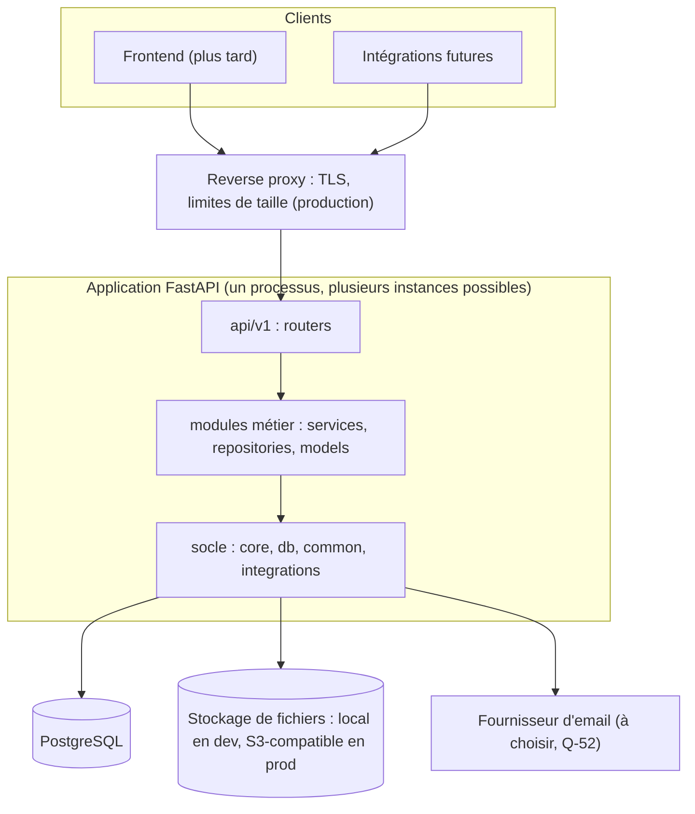

# Architecture du backend MadaSource

Jour 2 · 2026-10-12 · Statut : proposition à valider. Révisée après les revues `backend-architect` et `security-auditor` et la revue finale du Jour 2.

Notation des constats : « C1 » à « C35 » renvoient à la revue d'architecture (section 13). « C-1 », « E-1 », « M-1 », « F-1 »… renvoient à la relecture de sécurité ([security-design.md](security-design.md#22-relecture-de-sécurité-du-jour-2)). C1 et C-1 sont deux constats différents.

Documents liés :
- [module-boundaries.md](module-boundaries.md) : frontières et dépendances entre modules ;
- [api-conventions.md](api-conventions.md) : conventions REST ;
- [error-handling.md](error-handling.md) : erreurs ;
- [testing-strategy.md](testing-strategy.md) : tests ;
- [security-design.md](security-design.md) : sécurité.

Spécification fonctionnelle : documents du Jour 1 ([requirements.md](requirements.md), [business-rules.md](business-rules.md), [workflows.md](workflows.md)).

Chaque décision porte un identifiant **D-NN** et un statut :
- **Retenu** : imposé par une source (CdC, roadmap) ou choisi explicitement par l'utilisateur (date indiquée) ;
- **Proposé** : proposition argumentée de l'équipe, à confirmer avant implémentation. « Proposé (Q-NN) » signifie que la proposition attend la réponse du client à la question Q-NN ;
- **À VALIDER** : aucune proposition n'est retenue, la décision revient au client ou à un jour ultérieur.

Registre complet : section 12.

## 1. Contexte et principes

- Plateforme API-first : toute fonctionnalité est d'abord exposée par l'API REST (CdC §56). Le frontend, développé plus tard, et les intégrations futures sont des clients de cette API.
- Monolithe modulaire (RJ section 1) : une seule application déployée, découpée en modules métier aux frontières explicites. Ce choix est compatible avec le CdC §70, qui rejette les fonctionnalités futures codées en dur dans la première version, pas une application unique bien découpée (SRC-17).
- Évolutivité sans réécriture (CdC « Final requirement ») : feature flags, couche d'intégration, modèle de données extensible, workflows configurables (CdC §70).
- Pas de microservices ni d'infrastructure ajoutée sans besoin démontré (Redis, Celery, file de messages) (RJ section 1).

## 2. Vue d'ensemble



Une seule base PostgreSQL et un seul historique de migrations Alembic pour l'ensemble des modules (D-01, D-07).

## 3. Structure du code

Structure cible de la roadmap (RJ section 2), avec des écarts déclarés en D-03 :

```text
backend/app/
├── main.py              application factory : configuration, middlewares, routers, appel de wiring (aucune logique métier)
├── wiring.py            branchement des ports P-01 et P-03 et de leurs valeurs par défaut (composition root)
├── api/v1/router.py     agrège les routers des modules actifs sous /api/v1
├── api/v1/endpoints/    couche HTTP hors modules : santé (health.py) et routers des modules de niveau 1 à 3 (audit, auth, organizations)
├── core/                configuration, journalisation, primitives de sécurité, exceptions, feature flags, codes de catégories
├── db/                  base déclarative, session, conventions de nommage, tables techniques (compteurs D-16, supprimés si Q-37 est approuvée)
├── common/              noyau sans règle métier : Money, Quantity, Clock, Actor, pagination, identifiants, codes de référence
├── integrations/        interfaces et adaptateurs (stockage, email), outbox d'envoi (D-20)
├── modules/<module>/    un dossier par module métier, créé au jour de son implémentation
└── tasks/               traitements hors requête, seulement si un besoin est démontré (Jour 31)
```

Ordre interne du socle : `core` → `db` → `common` → `integrations`. Un élément du socle ne dépend que des éléments qui le précèdent.

Contenu type d'un module :

| Fichier | Rôle | Obligatoire |
|---|---|---|
| `router.py` | Endpoints HTTP minces : dépendances d'authentification et de permission, appel du service, **choix explicite du schéma de l'audience** (D-32) | Si le module expose des endpoints |
| `schemas.py` | Schémas HTTP Pydantic, un par audience (S-29) | Oui |
| `service.py` | Cas d'usage et règles métier, transitions d'état, transactions, audit | Oui |
| `contracts.py` | DTO immuables renvoyés aux autres modules, distincts des schémas HTTP (D-31) | Si le module est appelé par d'autres |
| `projections.py` | Requêtes de lecture publiées (`Select` limité aux colonnes et conditions autorisées) pour `marketplace` et `admin` : exception déclarée à D-31 ([module-boundaries.md](module-boundaries.md) §6) | Si le module publie des lectures publiques ou transverses |
| `models.py` | Modèles SQLAlchemy du module | Si le module possède des tables |
| `repository.py` | Requêtes ; `get_for_actor` et `list_for_actor` appliquent la politique d'accès. Les accès non filtrés (Système, admin) portent un nom explicite (S-14). | Si utile |
| `permissions.py` | Politique d'accès (acteur, action, ressource) → audience ou refus (S-28), et permissions nommées | Si le module a des endpoints privés |
| `ports.py` | Interface déclarée pour un appel vers un module supérieur | Seulement `access_control` (P-01) et `rfqs` (P-03) |

Aucun fichier vide n'est créé pour un module futur (RJ section 2).

## 4. Cycle de vie d'une requête

1. **Reverse proxy** (production) : TLS, taille maximale de requête, en-têtes de sécurité.
2. **Middlewares** : ASGI purs, pour s'appliquer aussi aux réponses d'erreur 500 (C31). Ils couvrent :
   - l'identifiant de requête (`X-Request-ID`, conservé dans une variable de contexte lue par le gestionnaire d'erreurs) ;
   - le journal d'accès ;
   - CORS ;
   - le marquage DEMO.
3. **Router** : FastAPI valide chemin, paramètres et corps (`extra="forbid"`).
4. **Dépendances** :
   - session de base de données ;
   - acteur courant, construit par `access_control` (D-31) ;
   - permission requise.
5. **Service** : politique d'accès, puis cas d'usage dans une unité de travail (section 5). Le service renvoie un DTO et l'audience retenue.
6. **Réponse** : le router instancie le schéma de cette audience (D-32). La réponse passe toujours par un modèle Pydantic, jamais par un dictionnaire contenant des `Decimal` (D-14).
7. **Erreurs** : traduites par le gestionnaire central ([error-handling.md](error-handling.md)), après annulation de la transaction.

## 5. Transactions et concurrence

| ID | Convention | Statut |
|---|---|---|
| D-08 | **Une requête = une session ; un cas d'usage d'écriture = une transaction.** La session est fournie par une dépendance qui l'annule et la ferme. Recommandation : portée `function` (`Depends(..., scope="function")`, FastAPI 0.121.0 et suivantes). D'après la documentation de FastAPI, avec la portée par défaut `request`, le code qui suit le `yield` s'exécute **après** l'envoi de la réponse (depuis 0.118.0). Une dépendance qui intercepte une exception doit la relancer (depuis 0.110.0). À vérifier sur la version épinglée (Jours 4-5). | Proposé (C19) |
| D-08 | Seule la fonction de cas d'usage appelée par le router **valide**, avant de retourner. Les fonctions exposées aux autres modules ne valident jamais et renvoient des **DTO immuables**, jamais des objets ORM qu'un appelant pourrait modifier (D-31). | Proposé (C15) |
| D-08 | Les repositories ne valident jamais. `expire_on_commit=False`. Les horodatages sont fixés par l'application (horloge injectable), pas par des valeurs par défaut du serveur : une colonne calculée par le serveur resterait expirée après validation, et sa lecture déclencherait une requête implicite qui échoue en asynchrone. À défaut : `eager_defaults=True`. | Proposé (C20) |
| D-08 | Jamais d'exécution concurrente (`asyncio.gather`) sur la session de la requête. | Proposé (C19) |
| D-29 | **Écritures qui doivent survivre à un refus** : révocation d'une session sur rejeu d'un jeton, compteurs d'échecs de connexion, événements d'audit de sécurité. Jamais par des « commit puis raise » dispersés. Mécanisme :<br>1. Le cas d'usage **enregistre l'effet** dans une liste propre à la requête, puis lève son exception.<br>2. La dépendance de session **annule d'abord** la transaction principale, ce qui libère ses verrous.<br>3. Elle exécute ensuite les effets dans une **nouvelle transaction**, validée seule.<br><br>Pourquoi annuler d'abord : une seconde session qui écrirait pendant que la transaction principale garde ses verrous attendrait jusqu'au `lock_timeout`, et l'effet serait perdu. Chaque effet est fourni par le module propriétaire des données : `auth` pour les sessions et les compteurs, `audit` pour les événements. Le socle (`db`) ne fournit que l'outil d'exécution. En test, cette transaction est un point de sauvegarde distinct sur la connexion de test, après l'annulation de celui de la requête ([testing-strategy.md](testing-strategy.md#4-base-de-données-de-test)). | Proposé (C2) |
| D-09 | **Transitions d'état** : verrouillage de la ligne de l'agrégat en `FOR NO KEY UPDATE` (`with_for_update(key_share=True)` en SQLAlchemy), avec `populate_existing`, puis revérification de l'état. `FOR NO KEY UPDATE` n'entre pas en conflit avec le `FOR KEY SHARE` que PostgreSQL prend lors du contrôle d'une clé étrangère à l'insertion d'une ligne fille. `FOR UPDATE` provoquerait des interblocages entre deux exportateurs qui répondent à la même RFQ. `populate_existing` garantit que l'état revérifié est celui de la ligne relue, et non celui d'un objet déjà en mémoire. | Proposé (C3, C4) |
| D-09 | **Ordre de verrouillage**, règle générale :<br>1. lecture sans verrou ;<br>2. verrouillage dans l'ordre croissant des niveaux de modules (RFQ → quotation → négociation → Trade → Payment Record / expédition) ;<br>3. le parent est toujours verrouillé avant toute insertion d'une ligne fille ;<br>4. le compteur de références en dernier (sans objet si Q-37 est approuvée : références aléatoires insérées dans un point de sauvegarde, [indexes-and-constraints.md](indexes-and-constraints.md) §4.3) ;<br>5. revérification. | Proposé (C18) |
| D-09 | **Idempotence** des actions critiques : contrôle d'état sous verrou et contrainte d'unicité en dernier rempart. Un second appel identique renvoie le résultat existant ; un appel contradictoire reçoit 409. `Idempotency-Key` : non requis en V1. | Proposé |
| D-09 | Interblocage (`40P01`), conflit de sérialisation (`40001`) ou attente de verrou expirée (`55P03`) : 409 `CONCURRENT_MODIFICATION`, que le client peut retenter. Requête annulée par `statement_timeout` (`57014`) : 503. Pas de nouvelle tentative automatique côté serveur en V1. | Proposé (C21) |
| D-16 | **Identifiants lisibles** (`RFQ-`, `MSQ-`, `MST-`) : table technique de compteurs du socle (`db`), une ligne par préfixe (et par année si la remise à zéro annuelle est retenue, Q-37), incrémentée par une seule instruction atomique dans la transaction de création, en dernier dans l'ordre de verrouillage. Unicité sous concurrence, pas de trou en cas d'annulation. Les créations d'un même préfixe sont sérialisées. Format : Q-37. | Proposé (Q-37). **Jour 3 : remplacement PROPOSED** par un suffixe aléatoire sans compteur (Q-37, [registre](../decisions/architecture-decisions.md) ; [indexes-and-constraints.md](indexes-and-constraints.md) §4.3) |

## 6. Configuration et environnements

| ID | Convention | Statut |
|---|---|---|
| D-11 | Configuration lue depuis les variables d'environnement et validée au démarrage par un objet typé (Pydantic v2 ; `pydantic-settings` à justifier au Jour 5 : le Jour 4 n'a aucune configuration applicative). Une configuration invalide empêche le démarrage. | Proposé |
| D-11 | Environnements : `local`, `test`, `staging` (si l'hébergement en prévoit un, Q-79), `production`, `demo` (section 8.2). | Proposé |
| D-11 | En `production`, le démarrage est refusé si : mode debug actif, secret par défaut ou trop court, `DEMO_MODE` actif, origines CORS `*`, adaptateurs de démonstration chargés. | Proposé |
| D-11 | `.env` uniquement en local, jamais versionné. Toute variable est documentée dans `.env.example` avec une valeur factice (Jour 4). | Retenu (RJ section 1) |

## 7. Conventions transverses

### 7.1 Dates et heures

- Stockage en `TIMESTAMP WITH TIME ZONE`, en UTC ; dans le code, uniquement des objets `datetime` timezone-aware (RJ section 1). D-13, Retenu.
- API : ISO 8601 avec `Z` pour les instants, `AAAA-MM-JJ` pour les dates calendaires ([api-conventions.md](api-conventions.md#7-dates-montants-quantités)).
- **Horloge injectable** (interface « Clock » dans `common`). Elle fixe aussi les horodatages enregistrés (D-08). D-13, Proposé.
- Échéances « en jours » : stockées comme un instant exact (`expires_at`) ; interprétation : Q-70.

### 7.2 Montants, devises et quantités

- `Decimal` en Python, `NUMERIC(p, s)` en base, jamais `float` (RJ section 1). D-14, Retenu.
- Tout montant porte sa devise (ISO 4217 ; USD et EUR en V1), toute quantité son unité.
- Valeurs `Money` et `Quantity` dans `common`, qui refusent de combiner deux devises ou deux unités sans conversion explicite. D-14, Proposé.
- **Entrée** : montants et quantités acceptés **uniquement en chaînes**, grâce à un type d'entrée dédié qui refuse les nombres (C29). FastAPI décode le JSON avant Pydantic : un nombre JSON y devient déjà un `float`. Et Pydantic accepte des entiers ou des flottants pour un `Decimal`, même en mode strict. D-14, Proposé.
- **Sortie** : toujours par un modèle Pydantic, qui sérialise un `Decimal` en chaîne (vérifié le 2026-10-12 avec Pydantic 2.13). Jamais par `jsonable_encoder` sur un dictionnaire, qui convertit les `Decimal` en `float`. D-14, Proposé.
- Taux de change dans une table dédiée, séparée des données transactionnelles. Toute conversion enregistre le taux, sa source et sa date. Un montant figé n'est jamais recalculé (CdC §59). Inclusion de la conversion en V1 : Q-65.

### 7.3 Identifiants

- Clés techniques UUID, jamais d'entier séquentiel exposé (RJ section 1).
- D-15, Proposé au Jour 4 (voir le paragraphe « Jour 4 » ci-dessous) : **UUIDv7**, ordonné dans le temps et plus favorable aux index. Deux options :
  - généré par l'application, avec `uuid.uuid7()`, natif à partir de Python 3.14 (vérifié le 2026-10-12 : présent en 3.14.8, absent en 3.12.14) ;
  - généré par PostgreSQL 18 (`uuidv7()`).
  Choix au Jour 4 avec D-27 et la version de PostgreSQL. Sinon, UUIDv4.

  **Jour 4 (2026-10-13)** : Python 3.14 et PostgreSQL 18 retenus par l'utilisateur. Proposition : identifiants générés par l'application (`uuid.uuid7()`), pour que la valeur soit connue avant l'insertion. Mise en œuvre au Jour 6.
- Un UUIDv7 révèle l'instant de création. Sa partie variable fait 74 bits ; dans CPython 3.14, elle se compose d'un compteur de 42 bits et d'environ 32 bits aléatoires (C30). La protection réelle reste le contrôle d'accès ([security-design.md](security-design.md)).
- Identifiants lisibles : D-16.

### 7.4 Journalisation

| ID | Convention | Statut |
|---|---|---|
| D-12 | Journaux JSON sur la sortie standard. Champs : horodatage UTC, niveau, logger, message, `request_id`, méthode, chemin, statut, durée, et identifiants (jamais noms ni emails) de l'utilisateur et de l'organisation. Un seul journal d'accès : celui de l'application, ou celui du serveur ASGI, pas les deux. | Proposé |
| D-12 | Nettoyage obligatoire : `Authorization`, cookies, `password`, `token`, `secret`, données bancaires. Aucun corps de requête ou de réponse journalisé par défaut. | Retenu (RJ 5, RJ 10) |
| D-12 | Composantes de prix (prix net, marge, coûts, commission) absentes des journaux applicatifs. | Proposé (S-21) |
| D-12 | Journal applicatif (exploitation) distinct du journal d'audit (métier, en base, ajout seul, Jour 12). | Retenu (RJ 12) |
| D-12 | Module `logging` standard et un formateur JSON, sans dépendance. Branchement d'un service de suivi d'erreurs possible plus tard. | Proposé |

### 7.5 Santé et disponibilité

- `/api/v1/health/live` (le processus répond) et `/api/v1/health/ready` (la base répond), dans `api/v1/endpoints/health.py` (RJ 5, RJ section 2).
- Les migrations ne sont **pas** appliquées au démarrage de l'application : c'est une étape distincte du déploiement (D-26).

## 8. Configuration fonctionnelle transverse

Classée V1 (A), mais prévue par aucun jour de la roadmap backend (SRC-18). Planification : Q-75.

### 8.1 Feature flags et codes de catégories (CdC §71)

| ID | Proposition | Statut |
|---|---|---|
| D-17 | Flags déclarés dans la configuration sous les noms du CdC (`VANILLA_ENABLED`…), lus au démarrage. Activation à chaud par l'admin : plus tard. | Proposé (Q-75) |
| D-17 | **Module désactivé ou non développé** : routes non montées, absentes de l'OpenAPI. **Catégorie désactivée** : absente des listes publiques, création refusée (`CATEGORY_DISABLED`), données existantes conservées (Q-78). | Proposé |
| D-30 | **Codes stables** de catégories (`vanilla`, `cloves`, `cocoa` ; en MAJUSCULES si Q-66 est approuvée, CF-07), définis dans `core` et liés aux flags. Les modules inférieurs à `products` (`buyers` : produits d'intérêt ; `exporters` : capacités) stockent ces codes sans clé étrangère. `products` détient les métadonnées de chaque catégorie (libellés par langue, attributs), indexées par le code. Les autres référentiels (pays ISO 3166, devises ISO 4217, Incoterms, liste des certifications selon Q-20) sont aussi des codes validés par le socle. Un module de référentiel de bas niveau ne sera créé que si ces listes deviennent administrables. | Proposé (C13) |
| D-17 | Consultation des flags par l'admin : `GET /api/v1/admin/feature-flags`. | Proposé |

### 8.2 Mode DEMO (CdC §68)

| ID | Proposition | Statut |
|---|---|---|
| D-18 | **Déploiement distinct** (`APP_ENV=demo`, `DEMO_MODE=true`), avec sa propre base, son propre stockage et ses propres secrets. Données simulées et réelles ne peuvent pas se mélanger (BR-DEMO-02). Production refusée avec `DEMO_MODE` (D-11). | Proposé (Q-67) |
| D-18 | Même code et même modèle de données (BR-DEMO-03). En V1, une simulation (confirmation de paiement, statut d'expédition, livraison) **exécute les cas d'usage normaux** par un acteur « Système DEMO » explicite (S-58). Elle est déclenchée par des endpoints admin montés seulement en environnement `demo`. Aucun adaptateur d'intégration dédié n'est nécessaire, puisqu'aucune intégration n'existe en V1 (C32). | Proposé |
| D-18 | Marquage :<br>- en-tête `X-MadaSource-Mode: demo` ;<br>- **préfixe DEMO** dans toute référence lisible, visible jusque sur une capture d'écran ;<br>- filigrane sur les documents générés ;<br>- emails désactivés ou limités à une liste blanche ;<br>- accès sur invitation (S-57). | Proposé |

### 8.3 Langues (CdC §58)

| ID | Proposition | Statut |
|---|---|---|
| D-19 | L'API échange des **codes stables** : statuts, catégories, types de documents, codes d'erreur. Le frontend affiche les libellés traduits (BR-I18N-01). | Proposé (Q-66). **Jour 3 : codes en MAJUSCULES PROPOSED** (Q-66, CF-07, [registre](../decisions/architecture-decisions.md)) |
| D-19 | Libellés des données de référence administrables (catégories, attributs) stockés par langue dans `products` (D-30). Forme proposée au Jour 3 : colonne JSON par langue ([data-model.md](data-model.md) §5.12). | Proposé (Q-66) |
| D-19 | Messages d'erreur en anglais en V1 ; le client s'appuie sur le `code`. Contenu saisi par les utilisateurs non traduit. | Proposé |

## 9. Intégrations et services externes

| ID | Proposition | Statut |
|---|---|---|
| D-21 | Toute dépendance externe passe par une **interface** du socle (`app/integrations/<capacité>/`) et des adaptateurs choisis par configuration (CdC §57). Les services dépendent de l'interface, jamais d'un fournisseur. | Retenu (principe) / Proposé (forme) |
| D-21 | V1 : stockage de fichiers (local en dev, S3-compatible en prod, Jour 29, D-22) et email (adaptateur console en local clairement identifié, fournisseur réel à choisir, Jours 11 et 31). Banque, paiement, logistique, inspection, douane, change : aucune interface avant décision. | Retenu (RJ 11, RJ 29) |
| D-21 | Appels sortants : délai d'expiration, nouvelles tentatives bornées, réponse du tiers validée (OWASP API10). Aucun appel externe depuis un router ni dans la transaction d'une requête. | Proposé |

## 10. Tâches asynchrones

| ID | Proposition | Statut |
|---|---|---|
| D-20 | **Aucune infrastructure asynchrone au départ.** Matching à la soumission, notifications in-app et audit tiennent dans la transaction. Les statuts dérivés du temps sont calculés à la lecture (D-23). | Proposé |
| D-20 | Effets externes (email réel, Jours 11 et 31) : intention écrite dans une **outbox du socle** (`integrations`) dans la même transaction, et accessible à tous les modules, y compris `auth`. Envoi **après validation**, hors requête, avec nouvelles tentatives et sans doublon. Technologie du traitement : à justifier au Jour 31. | Proposé (C14) |
| D-20 | Exceptions détectées automatiquement (retards, absence de réponse) : traitement planifié à concevoir avec Q-60. | À VALIDER |

## 11. Exploitation et montée en charge

- Application **sans état** (sessions en base, fichiers dans le stockage objet), donc plusieurs instances possibles.
- Pool de connexions dimensionné par instance ; un multiplexeur de connexions seulement si la mesure le justifie.
- Pagination bornée, index sur les filtres réels (Jour 3), chargement explicite des relations (pas de N+1).
- Pas de cache applicatif en V1.
- Volumétrie et objectifs : Q-72, mesurés à l'Audit C. Hébergement et localisation des données : Q-79. Déploiement, sauvegarde et restauration : Audit D.
- Développement : Docker Compose (backend et PostgreSQL) avec des ports hôte libres (5432, 6379 et 8000 sont occupés sur ce poste), au Jour 4.

## 12. Registre des décisions

| ID | Décision | Statut | Source / question |
|---|---|---|---|
| D-01 | Monolithe modulaire : une application FastAPI, une base PostgreSQL, un historique Alembic | Retenu | RJ section 1, CdC §70 (SRC-17) |
| D-02 | API REST versionnée sous `/api/v1`, documentée par OpenAPI | Retenu | RJ section 1, CdC §56 |
| D-03 | Structure RJ section 2 avec écarts déclarés : `integrations/`, `wiring.py`, `contracts.py`, `projections.py`, `ports.py` (deux modules) ; santé et routers des modules de niveau 1 à 3 dans `api/v1/endpoints/` ; dossier `tests/e2e` | Proposé | C24, revue finale |
| D-04 | Couches d'un module : router, schemas, service, contracts, repository, models, permissions | Retenu / Proposé | RJ section 1-2 |
| D-05 | Modules ordonnés en niveaux, dépendances uniquement vers les niveaux inférieurs, contrôle automatique en CI | Proposé | [module-boundaries.md](module-boundaries.md) |
| D-06 | Communication par appels descendants ; deux ports seulement (P-01, P-03) ; pas de bus d'événements en V1 | Proposé | C35 |
| D-07 | Pas de relation ORM entre modules ; clés étrangères seulement vers un module inférieur, par nom de table | Proposé | C12 |
| D-08 | Une transaction par cas d'usage, validée par le service avant la réponse ; DTO entre modules ; horodatages fixés par l'application | Proposé | C15, C19, C20 |
| D-09 | `FOR NO KEY UPDATE` et `populate_existing` ; ordre de verrouillage par niveau ; parent avant enfant ; idempotence | Proposé | C3, C4, C18 |
| D-10 | Pilote PostgreSQL asynchrone : **asyncpg** 0.32.0 (la lecture des codes SQLSTATE en dépend) | Retenu (choix de l'utilisateur, Jour 4, 2026-10-13) | RJ 4, C21 |
| D-11 | Configuration validée au démarrage, garde-fous en production | Proposé | RJ 5 |
| D-12 | Journaux JSON nettoyés, distincts de l'audit | Proposé | RJ 5, RJ 12 |
| D-13 | UTC partout, ISO 8601, horloge injectable | Retenu / Proposé | RJ section 1 |
| D-14 | Decimal et NUMERIC avec devise ; chaînes seulement en entrée ; sortie par modèles Pydantic | Retenu / Proposé | RJ section 1, C29 |
| D-15 | UUIDv7, généré par l'application (`uuid.uuid7()` de Python 3.14) | Proposé (découle de D-27, Jour 4) ; mise en œuvre au Jour 6 | C30 |
| D-16 | Table technique de compteurs par préfixe et par année | Proposé ; remplacement PROPOSED au Jour 3 (suffixe aléatoire) | Q-37 |
| D-17 | Feature flags par configuration ; module non monté ; catégorie masquée et refusée | Proposé | Q-75, Q-78 |
| D-18 | DEMO : déploiement distinct, simulations par les cas d'usage normaux, marquage visible | Proposé | Q-67, C32 |
| D-19 | Codes stables dans l'API, traduction côté frontend ; casse MAJUSCULE PROPOSED au Jour 3 (CF-07) | Proposé | Q-66 |
| D-20 | Pas d'infrastructure asynchrone au départ ; outbox du socle, envoi après validation | Proposé | RJ 31, C14 |
| D-21 | Interfaces et adaptateurs pour toute dépendance externe | Retenu / Proposé | CdC §57 |
| D-22 | Stockage de fichiers abstrait : local en dev, S3-compatible en prod | Retenu | RJ 29 |
| D-23 | Statuts dérivés du temps (validité, expiration) calculés à la lecture | Proposé | BR-QUO-03 |
| D-24 | Erreurs au format Problem Details (RFC 9457) avec code stable ; forme du membre `type` à fixer avant le Jour 5 | Proposé / À VALIDER | [error-handling.md](error-handling.md), C28 |
| D-25 | Objet hors périmètre de l'acteur : 404, comme un objet inexistant | Proposé | S-15 |
| D-26 | Migrations appliquées comme étape de déploiement, jamais au démarrage | Proposé | Audit D |
| D-27 | **Python 3.14** (3.14.8 en local, image `python:3.14.8-slim-trixie`) ; PostgreSQL 18 (`postgres:18.6-trixie`). Compatibilité des dépendances vérifiée au Jour 4 (`uv sync`, tests) | Retenu (choix de l'utilisateur, Jour 4, 2026-10-13) | RJ 4 |
| D-28 | **Statut de compte porté par l'organisation** (`organizations`, niveau 3), pour que l'acteur puisse être construit sans import montant. Valeurs :<br>- organisations acheteuses : statuts du CdC §10 (Pending, Active, Suspended, Blocked) ;<br>- organisations exportatrices : à définir (Q-12). Le CdC §36 prévoit Approve, Reject, Suspend et Reactivate, et un rejet n'a pas d'état cible dans la liste acheteur.<br><br>`buyers` et `exporters` orchestrent les décisions en appelant `organizations`. L'utilisateur (`auth`) porte ses propres états (email vérifié, compte désactivé). | Proposé (emplacement). Jour 3 : statuts exportateur **PROPOSED** (Q-12), portés par chaque capacité de l'organisation ([data-model.md](data-model.md) §5.4) ; conflits CF-01 et CF-02 ([registre](../decisions/architecture-decisions.md)) | C1, Q-11, Q-12, Q-13 |
| D-29 | Écritures de sécurité qui doivent survivre à un refus : enregistrées pendant la requête, exécutées après l'annulation de la transaction principale dans une transaction distincte, fournies par le module propriétaire (`auth`, `audit`) | Proposé | C2, revue finale |
| D-30 | Codes stables pour catégories et référentiels ; métadonnées des catégories dans `products` ; tables techniques (compteurs tant que D-16 est maintenue, outbox) dans le socle | Proposé | C13, C14 |
| D-31 | Contrats inter-modules : DTO immuables (`contracts.py`). Seule exception : les projections de lecture (`projections.py`), qui renvoient une requête `Select` limitée aux colonnes autorisées. L'acteur est défini dans `common` et construit par `access_control` : utilisateur, organisation, statut, permissions, session (avec indicateur de second facteur), instant d'authentification (S-35), acteur Système (S-58), intervention « pour le compte de » (S-32) | Proposé | C15, revue finale |
| D-32 | Choix explicite du schéma de réponse selon l'audience retournée par la politique ; jamais d'union de schémas résolue automatiquement par Pydantic (risque de servir le schéma admin) ; un chemin par audience quand c'est possible | Proposé | C16 |
| D-33 | Un cas d'usage multi-modules appartient au module de plus haut niveau concerné. En particulier, l'acceptation (directe ou après négociation) est orchestrée par `trades`, sur un chemin unique. | Proposé | C26, C35 |

## 13. Revue d'architecture du Jour 2

Relecture par l'agent `backend-architect`, en lecture seule, avec vérification dans les documentations officielles (FastAPI, SQLAlchemy, PostgreSQL, Python, Pydantic, RFC 9457, import-linter). Résultat : **1 constat bloquant, 15 majeurs, 18 mineurs, 1 suggestion**. Traitement :

| Constat | Sujet | Traitement |
|---|---|---|
| C1 (bloquant) | Cycle autour du statut de compte | D-28 |
| C2 | Écritures de sécurité annulées avec la transaction | D-29 |
| C3, C4, C18 | Verrous : état périmé, interblocages, ordre | D-09 |
| C5 | Respond attribué à `rfqs` | `quotations` ([module-boundaries.md](module-boundaries.md)) |
| C6 | P-01 sans audience, contextes manquants | P-01 redéfini ([module-boundaries.md](module-boundaries.md)) |
| C7 | Rendu des notifications à la lecture | Référence seule, lue par le client (S-52) |
| C8 | Lecture directe des tables contraire à E-8 | Projections publiées ([module-boundaries.md](module-boundaries.md)) |
| C9 | Ports sans valeur par défaut | Défauts documentés ([module-boundaries.md](module-boundaries.md)) |
| C10 | `exceptions` au même niveau que paiements et expéditions | Niveau 16 |
| C11, C12, C13 | Clés étrangères montantes, référentiels sans propriétaire | D-07, D-30 ; modèle conceptuel corrigé ([requirements.md](requirements.md)) |
| C14 | Outbox dans `notifications` | D-20 |
| C15 | Contrats incomplets, acteur mal placé | D-31 |
| C16 | Sélection du schéma dans une union | D-32 |
| C17 | P-03 réentrant | P-03 redéfini |
| C19, C20 | Portée de la session FastAPI, colonnes calculées par le serveur | D-08 |
| C21 | Codes SQLSTATE manquants | D-09 ; [error-handling.md](error-handling.md) |
| C22 | Lacunes du tableau des dépendances | [module-boundaries.md](module-boundaries.md) |
| C23 | Contrats import-linter | [module-boundaries.md](module-boundaries.md) §9 |
| C24 | Écarts non déclarés avec RJ section 2 | D-03 |
| C25 | Catalogue d'erreurs | [error-handling.md](error-handling.md) |
| C26, C35 | Deux chemins d'acceptation, ports remplaçables | D-33 ; ports réduits à P-01 et P-03 |
| C27 | Nommage des audiences, schémas et permissions | [api-conventions.md](api-conventions.md), skills mis à jour |
| C28 | URN non enregistré pour `type` | D-24, à valider |
| C29 | Nombres JSON acceptés pour les montants | D-14 |
| C30 | Aléa d'UUIDv7, option PostgreSQL 18 | D-15 |
| C31 | En-têtes absents des réponses 500 | Section 4 ; [error-handling.md](error-handling.md) |
| C32 | Adaptateurs DEMO inexistants en V1 | D-18 |
| C33 | Base de test | [testing-strategy.md](testing-strategy.md) |
| C34 | Repository « toujours filtré » | Section 3 |

**Revue finale** (skill `code-review-madasource`, agent `code-reviewer`). Elle a porté sur l'ensemble des documents du Jour 2 après ces corrections : 2 constats bloquants, 8 importants, 16 facultatifs, tous traités. Les principaux :
- ordre de construction des modules ([module-boundaries.md](module-boundaries.md) §11, Q-93) ;
- statut de S-18 ;
- dépendances montantes implicites (favoris, gestion des membres, interventions admin, coordonnées bancaires de MadaSource) ;
- exécution de D-29 après l'annulation ;
- statuts harmonisés.

Détail : [daily-reports/day-02.md](daily-reports/day-02.md).

## 14. Justification de la stack

Le CdC §77 (point 2) demande une recommandation de stack. La roadmap l'impose (RJ section 1) ; ce tableau en donne les raisons au regard des exigences de MadaSource.

| Composant | Statut | Raisons |
|---|---|---|
| Python (version : D-27) | Retenu | Écosystème mature pour les API et les données ; typage statique vérifiable |
| FastAPI | Retenu | API REST asynchrone ; validation des entrées par Pydantic ; schéma OpenAPI généré à partir du code (CdC §56, RJ 5) ; injection de dépendances adaptée aux contrôles d'accès par route |
| Pydantic v2 | Retenu | Schémas distincts par audience ; refus des champs inconnus ; sérialisation exacte des `Decimal` en chaînes |
| PostgreSQL | Retenu | Transactions ACID ; contraintes (CHECK, UNIQUE, clés étrangères) pour les invariants métier ; `NUMERIC` exact pour les montants ; verrous de ligne (`FOR NO KEY UPDATE`) pour les transitions concurrentes ; type JSON indexable envisageable pour les attributs variables par catégorie (Jour 3) |
| SQLAlchemy 2.x (asynchrone) | Retenu | Requêtes typées, contrôle explicite des transactions et des verrous, compatibilité asyncio |
| Alembic | Retenu | Migrations versionnées, relues, réversibles |
| Pytest | Retenu | Fixtures adaptées aux bases de test isolées et aux tests paramétrés (machines d'état) |
| Ruff | Retenu | Lint et formatage rapides, un seul outil |
| mypy | Proposé (Jour 4), à confirmer | Vérification de types en mode strict, avec le greffon Pydantic ; SQLAlchemy 2 est typé nativement |
| Docker Compose | Retenu | Environnement reproductible (backend et PostgreSQL), aligné avec la CI |
| uv | Retenu (Jour 4, version 0.13.0 imposée par `required-version`) | Verrouillage reproductible des dépendances (`uv.lock`) ; gestion des versions de Python |
| Redis, Celery | Non retenus au départ (D-20) | À introduire seulement si un besoin est démontré (Jour 31, limites de débit partagées au Jour 8) |
