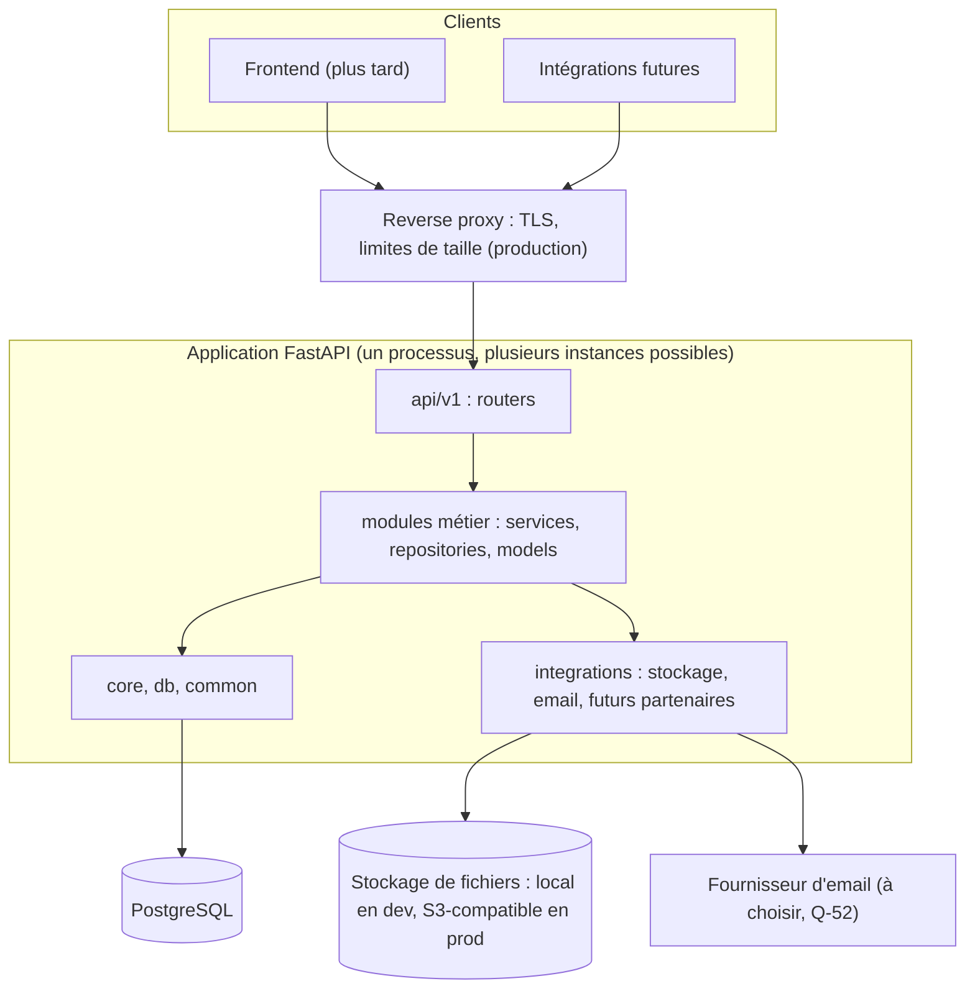

# Architecture du backend MadaSource

Jour 2 · 2026-10-12 · Statut : proposition à valider

Documents liés :
- [module-boundaries.md](module-boundaries.md) : frontières et dépendances entre modules ;
- [api-conventions.md](api-conventions.md) : conventions REST ;
- [error-handling.md](error-handling.md) : format et gestion des erreurs ;
- [testing-strategy.md](testing-strategy.md) : stratégie de tests ;
- [security-design.md](security-design.md) : conception de la sécurité.

Spécification fonctionnelle : documents du Jour 1 ([requirements.md](requirements.md), [business-rules.md](business-rules.md), [workflows.md](workflows.md)).

Chaque décision porte un identifiant **D-NN** et un statut :
- **Retenu** : imposé par une source (CdC, roadmap) ;
- **Proposé** : choix technique argumenté, à confirmer ;
- **À VALIDER** : dépend d'une question ouverte.
Le registre complet est en section 12.

## 1. Contexte et principes

- Plateforme API-first : toute fonctionnalité est d'abord exposée par l'API REST (CdC §56). Le frontend, développé plus tard, et les intégrations futures sont des clients de cette API.
- Monolithe modulaire (RJ section 1) : une seule application déployée, découpée en modules métier aux frontières explicites. Ce choix est compatible avec le CdC §70, qui rejette les fonctionnalités futures codées en dur dans la première version, pas une application unique bien découpée (SRC-17).
- Évolutivité sans réécriture (CdC « Final requirement ») : feature flags, couche d'intégration, modèle de données extensible, workflows configurables (CdC §70).
- Pas de microservices, pas d'infrastructure ajoutée sans besoin démontré (Redis, Celery, file de messages) (RJ section 1).

## 2. Vue d'ensemble



Une seule base PostgreSQL et un seul historique de migrations Alembic pour l'ensemble des modules (D-01, D-07).

## 3. Structure du code

Structure cible de la roadmap (RJ section 2), avec un ajout proposé (`integrations/`) :

```text
backend/app/
├── main.py              application factory : assemble configuration, middlewares, routers, ports (aucune logique métier)
├── wiring.py            proposé : branchement des ports inter-modules (composition root, voir module-boundaries.md)
├── api/v1/router.py     agrège les routers des modules actifs sous /api/v1
├── core/                configuration, journalisation, sécurité (primitives), exceptions, feature flags
├── db/                  base déclarative, session, conventions de nommage des contraintes
├── common/              noyau partagé sans règle métier : Money, Quantity, pagination, horloge, identifiants, schémas de base
├── integrations/        proposé (CdC §57) : interfaces et adaptateurs (stockage, email ; plus tard banque, logistique…)
├── modules/<module>/    un dossier par module métier, créé seulement au jour de son implémentation
└── tasks/               tâches asynchrones, seulement si un besoin est démontré (Jour 31)
```

Contenu type d'un module (RJ section 2) :

| Fichier | Rôle | Obligatoire |
|---|---|---|
| `router.py` | Endpoints HTTP minces : paramètres, dépendances d'authentification et de permission, appel du service, schéma de réponse | Oui, si le module expose des endpoints |
| `schemas.py` | Schémas Pydantic d'entrée et de sortie, distincts par audience (public, Buyer, Exporter, Admin) | Oui |
| `service.py` | Cas d'usage et règles métier, transitions d'état, transactions, audit | Oui |
| `models.py` | Modèles SQLAlchemy du module | Si le module possède des tables |
| `repository.py` | Requêtes réutilisées ou complexes, toujours filtrées par acteur | Si utile |
| `permissions.py` | Permissions nommées du module et contrôles d'appartenance | Oui, si le module a des endpoints privés |
| `ports.py` | Interfaces que le module déclare pour des appels vers un module de niveau supérieur | Proposé, seulement si nécessaire |

Aucun fichier vide n'est créé pour un module futur (RJ section 2).

## 4. Cycle de vie d'une requête

1. **Reverse proxy** (production) : TLS, taille maximale de requête, en-têtes de sécurité. Choix et configuration : Audit D et [security-design.md](security-design.md).
2. **Middlewares de l'application** :
   - identifiant de requête (`X-Request-ID` repris ou généré) ;
   - journal d'accès ;
   - CORS (origines autorisées configurées) ;
   - marquage du mode DEMO (section 8.2).
3. **Router** : FastAPI valide chemin, paramètres et corps avec les schémas d'entrée (`extra="forbid"`).
4. **Dépendances** :
   - session de base de données propre à la requête ;
   - acteur courant : utilisateur, organisation, rôles et permissions, résolu par `access_control` ;
   - permission requise par l'endpoint.
5. **Service** : cas d'usage dans une unité de travail (section 5) :
   - contrôle d'appartenance ;
   - règles métier ;
   - écritures ;
   - audit ;
   - notifications in-app ;
   - validation (commit).
6. **Réponse** : sérialisation par le schéma de l'audience de l'acteur (`response_model` explicite).
7. **Erreurs** : toute exception est traduite par un gestionnaire central au format défini dans [error-handling.md](error-handling.md), après annulation de la transaction.

Le router ne contient aucune règle métier et ne valide jamais une transaction (RJ section 1, CLAUDE.md).

## 5. Transactions et concurrence

| ID | Convention | Statut |
|---|---|---|
| D-08 | **Une requête = une session ; un cas d'usage d'écriture = une transaction.** La session est fournie par une dépendance qui garantit annulation et fermeture en fin de requête. Seule la fonction de cas d'usage appelée par le router valide la transaction, et toujours **avant** de retourner : la réponse n'est jamais envoyée avant le commit, quelle que soit la version de FastAPI. | Proposé |
| D-08 | Les fonctions publiques qu'un module expose aux autres modules **ne valident jamais** : elles s'exécutent dans la transaction de l'appelant. C'est ce qui garantit l'atomicité des opérations multi-modules (création d'un Trade, BR-TRD-02). | Proposé |
| D-08 | Les repositories ne valident jamais. Sessions configurées avec `expire_on_commit=False`, pour que les objets restent lisibles après validation sans rechargement implicite. | Proposé |
| D-09 | **Transitions d'état** : la ligne de l'agrégat (RFQ, négociation, Trade, Payment Record, expédition) est verrouillée (`SELECT … FOR UPDATE`) au début du cas d'usage, puis l'état est revérifié avant la transition. Isolation PostgreSQL par défaut (READ COMMITTED) avec verrous explicites. | Proposé |
| D-09 | **Ordre de verrouillage** fixe, pour éviter les interblocages : RFQ → quotation → négociation → Trade → Payment Record / expédition. | Proposé |
| D-09 | **Idempotence** des actions critiques (acceptation, création de Trade, confirmation de paiement) : contrôle d'état sous verrou et contrainte d'unicité en dernier rempart (par exemple un seul Trade par offre acceptée). Un second appel identique renvoie le résultat existant ; un appel contradictoire reçoit un 409. En-tête `Idempotency-Key` : non requis en V1, envisageable plus tard. | Proposé |
| D-09 | Un interblocage ou un conflit de sérialisation détecté par PostgreSQL est renvoyé en 409 `CONCURRENT_MODIFICATION`, que le client peut retenter. Pas de nouvelle tentative automatique côté serveur en V1. | Proposé |
| D-16 | **Identifiants lisibles** (`RFQ-`, `MSQ-`, `MST-`) : compteur par préfixe et par année, incrémenté par une seule instruction atomique dans la transaction de création. Avantages : unicité sous concurrence, remise à zéro annuelle naturelle, pas de trou si la transaction est annulée. Inconvénient accepté : les créations du même préfixe sont sérialisées. Format : Q-37. | Proposé |

## 6. Configuration et environnements

| ID | Convention | Statut |
|---|---|---|
| D-11 | Configuration lue depuis les variables d'environnement et validée au démarrage par un objet de configuration typé (Pydantic v2 ; la bibliothèque dédiée `pydantic-settings` est à justifier au Jour 4). Une configuration invalide empêche le démarrage. | Proposé |
| D-11 | Environnements : `local`, `test`, `staging` (si l'hébergement en prévoit un, Q-79), `production`, et `demo` (section 8.2). | Proposé |
| D-11 | En `production`, le démarrage est refusé si : mode debug actif, secret par défaut ou trop court, `DEMO_MODE` actif, origines CORS génériques (`*`). | Proposé |
| D-11 | `.env` uniquement en local, jamais versionné. Toute variable est documentée dans `.env.example` avec une valeur factice (Jour 4). | Retenu (RJ section 1) |

## 7. Conventions transverses

### 7.1 Dates et heures

- Stockage : `TIMESTAMP WITH TIME ZONE`, en UTC. Code : objets `datetime` timezone-aware uniquement (RJ section 1). D-13, Retenu.
- API : ISO 8601 avec suffixe `Z` pour les instants. Date seule (`AAAA-MM-JJ`) pour les dates calendaires (par exemple une date de livraison cible). Détails : [api-conventions.md](api-conventions.md#7-dates-montants-quantités).
- Horloge injectable (une interface « Clock » dans `common`), pour tester les expirations sans dépendre de l'heure réelle. D-13, Proposé.
- Échéances « en jours » : stockées comme un instant d'expiration exact (`expires_at`). L'interprétation (fin de journée, fuseau) reste ouverte (Q-70).

### 7.2 Montants, devises et quantités

- `Decimal` en Python, `NUMERIC(p, s)` en base, jamais `float` (RJ section 1). D-14, Retenu.
- Un montant est toujours accompagné de sa devise (code ISO 4217 ; USD et EUR en V1, liste extensible) (CdC §59).
- Une quantité est toujours accompagnée de son unité (BR-PRD-03).
- Valeurs `Money` et `Quantity` dans `common`, avec des opérations qui refusent de combiner deux devises ou deux unités différentes sans conversion explicite. D-14, Proposé.
- JSON : montants et quantités sérialisés en chaînes (`"43.30"`), pour éviter toute perte de précision côté client. C'est le comportement par défaut de Pydantic v2, vérifié le 2026-10-12. D-14, Proposé.
- Taux de change dans une table dédiée, séparée des données transactionnelles. Toute conversion enregistre le taux, sa source et sa date. Un montant figé (Trade) n'est jamais recalculé (CdC §59, BR-CUR-02). Inclusion de la conversion en V1 : Q-65.

### 7.3 Identifiants

- Clés techniques UUID, jamais d'entier séquentiel exposé (RJ section 1).
- Version proposée, D-15, `À VALIDER` : **UUIDv7**, ordonné dans le temps, meilleur pour les index. Il est généré par l'application : natif à partir de Python 3.14 (vérifié le 2026-10-12 : présent en 3.14.8, absent en 3.12.14). Si le Jour 4 retient Python 3.12 ou 3.13, utiliser UUIDv4, ou ajouter une bibliothèque justifiée.
- UUIDv7 révèle l'instant de création, ce qui est acceptable ici. Sa partie aléatoire (74 bits) le rend non devinable, mais la protection réelle reste le contrôle d'accès (BOLA, [security-design.md](security-design.md)).
- Identifiants lisibles : voir D-16.

### 7.4 Journalisation

| ID | Convention | Statut |
|---|---|---|
| D-12 | Journaux structurés JSON sur la sortie standard, une ligne par événement. Champs : horodatage UTC, niveau, logger, message, `request_id`, méthode, chemin, statut, durée, identifiants (jamais noms ni emails) de l'utilisateur et de l'organisation. | Proposé |
| D-12 | Filtre de nettoyage obligatoire : en-tête `Authorization`, cookies, champs `password`, `token`, `secret`, données bancaires. Aucun corps de requête ou de réponse n'est journalisé par défaut. | Retenu (RJ 5, RJ 10) |
| D-12 | Journal applicatif (exploitation) ≠ journal d'audit (métier, en base, ajout seul, module `audit`, Jour 12). | Retenu (RJ 12) |
| D-12 | Bibliothèque : module `logging` standard plus un formateur JSON, sans dépendance par défaut. Service de suivi d'erreurs (« Sentry-ready », roadmap full-stack) : branchement possible plus tard. | Proposé |

### 7.5 Santé et disponibilité

- `/api/v1/health/live` : le processus répond.
- `/api/v1/health/ready` : la base répond (RJ 5).
- Les migrations ne sont **pas** appliquées au démarrage de l'application : c'est une étape distincte du déploiement, pour éviter que plusieurs instances migrent en même temps. D-26, Proposé.

## 8. Configuration fonctionnelle transverse

Ces sujets sont classés V1 (A) mais ne sont prévus par aucun jour de la roadmap backend (SRC-18). Leur conception est proposée ici ; la planification de leur implémentation reste à valider (Q-75).

### 8.1 Feature flags (CdC §71)

| ID | Proposition | Statut |
|---|---|---|
| D-17 | Flags déclarés dans la configuration, sous les noms du CdC (`VANILLA_ENABLED`, `CLOVES_ENABLED`, `COCOA_ENABLED`, `PRODUCER_MODULE_ENABLED`…). Ils sont lus au démarrage : un changement demande un redémarrage. Une activation à chaud par l'admin (flags en base) reste possible plus tard. | Proposé (Q-75) |
| D-17 | **Module désactivé ou non développé** : ses routes ne sont pas montées, donc absentes de l'API et de l'OpenAPI. Jamais d'endpoint qui simule un fonctionnement (BR-FLG-01). | Proposé |
| D-17 | **Catégorie désactivée** : elle n'apparaît plus dans les listes publiques ni dans les catégories disponibles. Toute création dans cette catégorie (produit, RFQ) est refusée avec le code `CATEGORY_DISABLED`. Les données existantes ne sont jamais supprimées. Effet sur les RFQ et Trades en cours : Q-78. | Proposé |
| D-17 | L'admin peut consulter l'état des flags en lecture (`GET /api/v1/admin/feature-flags`). | Proposé |

### 8.2 Mode DEMO (CdC §68)

| ID | Proposition | Statut |
|---|---|---|
| D-18 | Le mode DEMO est un **déploiement distinct** (`APP_ENV=demo`, `DEMO_MODE=true`), avec sa propre base et son propre stockage. Données simulées et réelles ne peuvent donc jamais se mélanger (BR-DEMO-02). | Proposé (Q-67) |
| D-18 | Même code et même modèle de données que la production (BR-DEMO-03). Les simulations (confirmation de paiement, statut d'expédition, livraison, confirmation partenaire) sont des **adaptateurs de démonstration** des interfaces d'intégration, activés uniquement en environnement `demo`. | Proposé |
| D-18 | Chaque réponse d'une instance DEMO porte l'en-tête `X-MadaSource-Mode: demo`. Les données de démonstration sont manifestement fictives. | Proposé |
| D-18 | Une instance de production refuse de démarrer avec `DEMO_MODE=true` (D-11). | Proposé |

### 8.3 Langues (CdC §58)

| ID | Proposition | Statut |
|---|---|---|
| D-19 | L'API échange des **codes stables** et indépendants de la langue : statuts, catégories, types de documents, codes d'erreur. Le frontend affiche les libellés traduits (anglais, français ; malgache plus tard) (BR-I18N-01). | Proposé (Q-66) |
| D-19 | Données de référence administrables (catégories, attributs qualité) : libellés stockés par langue, pour pouvoir ajouter une catégorie sans redéployer le frontend. Forme exacte : Jour 3. | Proposé (Q-66) |
| D-19 | Messages d'erreur (`title`, `detail`) en anglais en V1. Le client s'appuie sur le `code`. Support de l'en-tête `Accept-Language` : plus tard si nécessaire. | Proposé |
| D-19 | Le contenu saisi par les utilisateurs (descriptions, messages) n'est pas traduit par la plateforme. | Proposé |

## 9. Intégrations et services externes

| ID | Proposition | Statut |
|---|---|---|
| D-21 | Toute dépendance externe passe par une **interface** déclarée dans `app/integrations/<capacité>/` et des adaptateurs interchangeables, choisis par configuration (CdC §57, RFS section 1). Les services métier dépendent de l'interface, jamais d'un fournisseur. | Retenu (principe) / Proposé (forme) |
| D-21 | V1 : stockage de fichiers (adaptateur local en dev, S3-compatible en prod, Jour 29, D-22) et email (adaptateur console en local clairement identifié, fournisseur réel à choisir, Jours 11 et 31). Banque, paiement, logistique, inspection, douane et change : aucune interface implémentée avant décision. | Retenu (RJ 11, RJ 29) |
| D-21 | Appels sortants : délai d'expiration systématique, nouvelles tentatives bornées, réponse du tiers traitée comme non fiable et validée (OWASP API10). Aucun appel externe depuis un router. | Proposé |

## 10. Tâches asynchrones

| ID | Proposition | Statut |
|---|---|---|
| D-20 | **Aucune infrastructure asynchrone en V1 au départ.** Les traitements identifiés tiennent dans la transaction de la requête : matching à la soumission (volumes V1 faibles), notifications in-app (écritures en base), audit. Les statuts dérivés du temps (validité des quotations, expiration des vérifications) sont calculés à la lecture (D-23). | Proposé |
| D-20 | Dès qu'un effet externe existe (email réel, Jours 11 et 31), écrire l'intention dans une **table d'envoi transactionnelle (outbox)** dans la même transaction, puis la traiter hors requête avec nouvelles tentatives et sans doublon. Technologie du traitement (Celery et Redis, ou processeur plus simple) : à justifier au Jour 31. | Proposé (RJ 31) |
| D-20 | Les exceptions détectées automatiquement (retards, absence de réponse) demandent un traitement planifié, à concevoir avec Q-60. | À VALIDER |

## 11. Exploitation et montée en charge

- Application **sans état** : sessions de rafraîchissement en base, fichiers dans le stockage objet. Plusieurs instances peuvent tourner derrière le reverse proxy.
- Pool de connexions dimensionné par instance. Un multiplexeur de connexions (type PgBouncer) n'est à prévoir que si la mesure le justifie.
- Pagination obligatoire sur toute liste, taille de page bornée ([api-conventions.md](api-conventions.md)) ; index sur les filtres réels (Jour 3) ; chargement explicite des relations pour éviter les requêtes N+1.
- Pas de cache applicatif en V1. Les pages publiques du catalogue pourront utiliser les en-têtes de cache HTTP plus tard.
- Volumétrie et objectifs (temps de réponse, disponibilité, RPO/RTO) : Q-72. Mesures : Audit C.
- Développement : Docker Compose (backend et PostgreSQL) avec des ports hôte libres sur ce poste (5432, 6379 et 8000 sont occupés), au Jour 4.
- Hébergement de production et localisation des données : Q-79. Procédure de déploiement, sauvegarde et restauration : Audit D.

## 12. Registre des décisions

| ID | Décision | Statut | Source / question |
|---|---|---|---|
| D-01 | Monolithe modulaire : une application FastAPI, une base PostgreSQL, un historique Alembic | Retenu | RJ section 1, CdC §70 (SRC-17) |
| D-02 | API REST versionnée sous `/api/v1`, documentée par OpenAPI | Retenu | RJ section 1, CdC §56 |
| D-03 | Structure RJ section 2, plus `app/integrations/` et `app/wiring.py` | Proposé | CdC §57 |
| D-04 | Couches d'un module : router, schemas, service, repository facultatif, models, permissions | Retenu | RJ section 1-2 |
| D-05 | Modules ordonnés en niveaux, dépendances uniquement vers les niveaux inférieurs, contrôle automatique en CI | Proposé | [module-boundaries.md](module-boundaries.md) |
| D-06 | Communication inter-modules par appels descendants et ports ; pas de bus d'événements en V1 | Proposé | [module-boundaries.md](module-boundaries.md) |
| D-07 | Pas de relation ORM entre modules ; clés étrangères par nom de table | Proposé | [module-boundaries.md](module-boundaries.md) |
| D-08 | Une transaction par cas d'usage, validée par le service avant la réponse | Proposé | RJ section 1 |
| D-09 | Verrous de ligne, ordre de verrouillage fixe, idempotence par l'état et l'unicité | Proposé | RJ 26-27 |
| D-10 | Pilote PostgreSQL asynchrone : asyncpg ou psycopg 3 | À VALIDER (Jour 4) | RJ 4 |
| D-11 | Configuration validée au démarrage, garde-fous en production | Proposé | RJ 5 |
| D-12 | Journaux JSON, nettoyage des secrets, distincts de l'audit | Proposé | RJ 5, RJ 12 |
| D-13 | UTC partout, ISO 8601, horloge injectable | Retenu / Proposé | RJ section 1 |
| D-14 | Decimal et NUMERIC avec devise ; montants JSON en chaînes ; taux de change séparés | Retenu / Proposé | RJ section 1, CdC §59 |
| D-15 | UUIDv7 généré par l'application si Python ≥ 3.14 | À VALIDER (Jour 4) | Version Python |
| D-16 | Compteur annuel par préfixe pour les identifiants lisibles | Proposé | Q-37 |
| D-17 | Feature flags par configuration ; module désactivé non monté ; catégorie désactivée masquée et refusée | Proposé | Q-75, Q-78 |
| D-18 | Mode DEMO = déploiement distinct avec adaptateurs de démonstration | Proposé | Q-67 |
| D-19 | Codes stables dans l'API, traduction côté frontend, libellés de référence par langue | Proposé | Q-66 |
| D-20 | Pas d'infrastructure asynchrone au départ ; outbox pour les effets externes | Proposé | RJ 31 |
| D-21 | Interfaces et adaptateurs pour toute dépendance externe | Retenu / Proposé | CdC §57 |
| D-22 | Stockage de fichiers abstrait : local en dev, S3-compatible en prod | Retenu | RJ 29 |
| D-23 | Statuts dérivés du temps (validité, expiration) calculés à la lecture | Proposé | BR-QUO-03 |
| D-24 | Erreurs au format Problem Details (RFC 9457) avec code stable | Proposé | [error-handling.md](error-handling.md) |
| D-25 | Ressource d'une autre organisation : réponse 404, comme une ressource inexistante | Proposé | [security-design.md](security-design.md) |
| D-26 | Migrations appliquées comme étape de déploiement, jamais au démarrage de l'application | Proposé | Audit D |
| D-27 | Version de Python : 3.14 recommandée (dernière stable, UUIDv7 natif, identique au poste), sous réserve de compatibilité de toutes les dépendances vérifiée au Jour 4 ; sinon 3.13 ou 3.12 | À VALIDER (Jour 4) | RJ 4 |
