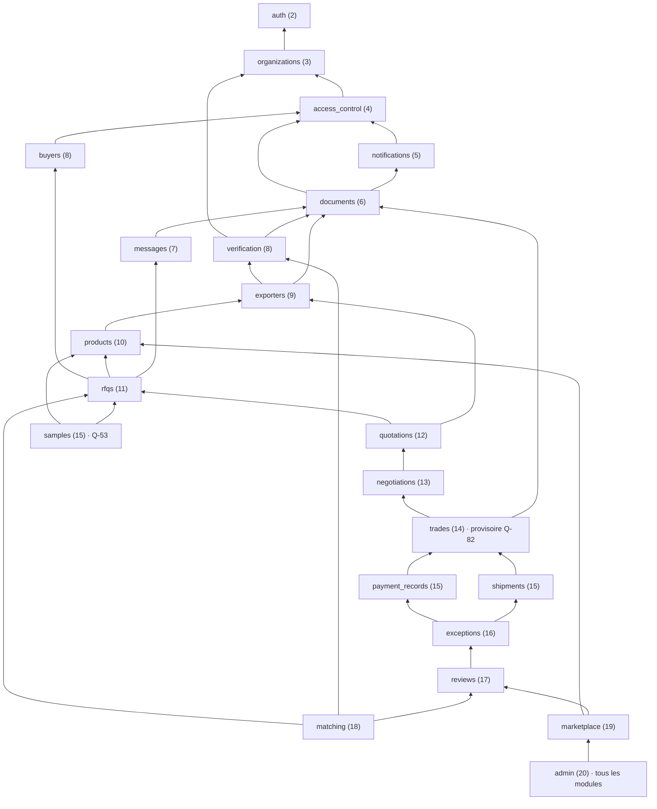
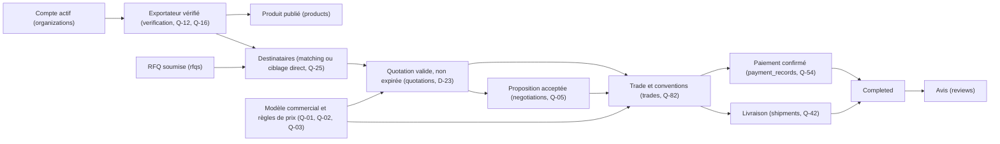

# Graphe de dépendances — backend MadaSource

Jour 3 · 2026-10-13 · Statut : PROPOSED (Q-93, [registre des décisions](../decisions/architecture-decisions.md#q-93--ordre-de-construction)).

Ce document est demandé par la réponse à Q-93. Il sert **avant chaque jour de la roadmap** à vérifier que les prérequis existent et sont testés. Il ne modifie pas la roadmap : un changement d'ordre est proposé ici, puis validé par l'utilisateur avant d'être appliqué.

Documents liés :
- [module-boundaries.md](module-boundaries.md) : niveaux des modules (§3) et stratégies de construction (§11) ;
- [data-model.md](data-model.md) et [erd.mmd](erd.mmd) : dépendances de données (clés étrangères).

## 1. Règles

| Règle | Source |
|---|---|
| Un module ne dépend que du socle et des modules de niveau strictement inférieur. Un appel montant passe par un port (P-01, P-03). | D-07, module-boundaries §3 et §5 |
| Une clé étrangère ne pointe jamais vers un module de niveau supérieur. Vérifié sur l'ERD par un script au Jour 3, puis par le test d'architecture au Jour 7. | D-07 |
| Avant chaque jour : vérifier les dépendances requises (section 4), confirmer que les modules prérequis existent et sont testés, signaler les questions bloquantes. | Q-93 |
| L'ordre peut être ajusté, **sans étendre le périmètre en silence**. Tout changement de séquence est noté en section 6 et validé par l'utilisateur. | Q-93, CLAUDE.md |
| La création du Trade attend que la quotation, la négociation et les règles du modèle commercial soient stables (Q-01, Q-05, Q-82). | Q-93 |

## 2. Graphe des modules

Dépendances **directes** entre modules (appels de service), d'après module-boundaries §3. Toutes les flèches descendent vers un niveau inférieur. `audit` (utilisé par presque tous les modules) et le socle sont omis pour la lisibilité.

Liens notables :
- `matching` → `reviews` n'existe que si Q-32 retient la performance historique dès la V1.
- `rfqs` → `matching` passe par le port P-03 (soumission d'une RFQ), jamais par un import.
- `documents` et `messages` → contexte des autres modules : port P-01, qui renvoie une audience.

## 3. Prérequis métier

Le graphe des modules ne suffit pas : certaines fonctions exigent qu'une **règle** ou un **état** d'un autre module soit en place.

| Fonction | Prérequis | Contrôle backend | Source |
|---|---|---|---|
| Publier un produit | Exportateur actif **et** vérifié | Service `products`, via `verification` | Q-12 (PROPOSED), BR-VER-03 |
| Apparaître dans le matching, recevoir une RFQ du système ou ciblée | Exportateur actif et vérifié ; le ciblage direct ne contourne aucune règle | Services `matching` et `rfqs` | Q-12, Q-25 |
| Envoyer une quotation | Exportateur vérifié, destinataire actif de la RFQ | Service `quotations` ; clé composite vers `rfq_recipients` | Q-12, S-30 |
| Accepter une quotation ou une proposition | Version non expirée, présentée à l'acheteur | Service `trades` (orchestration, D-33) | BR-QUO-03, S-43 |
| Créer le Trade | Quotation acceptée, négociation close, modèle commercial figé | Service `trades` | Q-82, Q-93 |
| Enregistrer un paiement | Trade existant ; convention concernée | Service `payment_records` | S-40, Q-54 |
| Passer en Completed | Conditions de Q-42 | Service `trades` | Q-42 |
| Évaluer | Trade Completed | Service `reviews` | BR-REP-01 |

## 4. Prérequis par jour de la roadmap

Pour chaque jour : tables créées (d'après le modèle de données), prérequis à vérifier, questions à trancher. Les questions en gras **bloquent** le jour.

| Jour | Module(s), tables | Prérequis | Questions |
|---|---|---|---|
| 4 | Squelette du dépôt, socle | Jours 1 à 3 validés ; `.gitignore` complété (`.env`, environnements virtuels) | **Q-71** (visibilité du dépôt) ; D-15, D-27 |
| 5 | `core`, `common` ; erreurs | Jour 4 | — |
| 6 | `db` : convention de nommage, rôles PostgreSQL (indexes-and-constraints §1 et §6) | Jours 4 et 5 | D-10 (pilote), version de PostgreSQL |
| 7 | Qualité, CI, test d'architecture (D-07) | Jours 4 à 6 | — |
| 8 | Primitives de sécurité (hachage, jetons) | Jour 5 | — |
| 9 | `users` (noyau), `organizations`, `organization_capabilities`, `organization_memberships`, `organization_invitations`, `roles`, `permissions`, `role_permissions`, `platform_role_assignments` | Jours 6 et 8 | Q-09, Q-10, Q-74 (PROPOSED, à approuver) ; Q-89, Q-98 |
| 10 | `sessions`, `refresh_tokens` | Jour 9 | Q-14, Q-80 |
| 11 | `email_verification_tokens`, `password_reset_tokens` ; `outbox_messages` si email réel | Jour 10 | Q-11, Q-12, Q-13, Q-52 |
| 12 | `audit_logs` ; rétro-branchement des Jours 9 à 11 | Jour 6 | Q-69 |
| 13 | `buyer_profiles` | Jours 9 à 12 | Q-11, Q-63 |
| 14 | `exporter_profiles`, `exporter_public_slugs`, `capacity_records`, `exporter_certifications`, `bank_details` ; **noyau documentaire** si CF-08 est tranché ainsi | Jours 9 à 12 | **CF-08** ; Q-12, Q-81, Q-87, Q-90 |
| 15 | `verification_records`, `verification_reviewed_documents` | Jour 14 ; documents (CF-08) | Q-12, Q-15, Q-16, Q-90 |
| 16 | `category_definitions`, `category_attributes` | Jour 6 | **Q-18** ; Q-06, Q-20, Q-21, Q-66, Q-78 |
| 17 | `products`, `product_attribute_values` | Jours 15 et 16 (publication réservée aux exportateurs vérifiés) | Q-19 |
| 18 | `marketplace` (projections) | Jours 15 et 17 | Q-06, Q-16, Q-17, Q-28, Q-86 |
| 19 | `rfqs`, `rfq_items` ; générateur de références (socle) | Jours 13 et 16-17 | Q-21, Q-24, Q-25, Q-37 |
| 20 | `rfq_recipients` (ciblage direct) | Jour 19 | Q-25, Q-28 |
| 21 | `rfq_questions` ; inbox ; Respond (SQ-03) | Jours 15, 19 et 20 | Q-24, Q-27, Q-84, Q-85 |
| 22 | `matching_configs`, `match_runs`, `rfq_matches` | Jours 15, 17, 19 à 21 | Q-16, Q-30, Q-32 |
| 23 | Workflow du matching | Jour 22 | Q-31 |
| 24 | `pricing_rule_versions`, `external_costs`, `quotations`, `quotation_versions`, `quotation_version_financials`, `quotation_lines`, `quotation_version_costs` | Jours 19 à 21 | **Q-01** ; Q-02, Q-03, Q-04, Q-08, Q-34, Q-82, Q-91, Q-94 |
| 25 | Validité et comparaison ; `exchange_rates` si Q-65 | Jour 24 | Q-34, Q-65, Q-91 |
| 26 | `negotiations`, `negotiation_offers`, `negotiation_offer_lines`, `negotiation_offer_financials`, `offer_external_costs` | Jours 24 et 25 | **Q-05** ; Q-38, Q-39 |
| 27 | `trades`, `trade_items`, `trade_agreements`, `trade_agreement_lines`, `trade_financials` | Jours 24 à 26 stables ; modèle commercial validé | **Q-82** ; Q-26, Q-95, Q-98 |
| 28 | `trade_events` ; machine d'état | Jour 27 | **Q-41** ; Q-44, Q-46 |
| 29 | `documents`, `document_versions` (complets) | Jour 9 (P-01) | Q-47, Q-48, Q-69, Q-83, Q-96 |
| 30 | `conversations`, `conversation_participants`, `messages`, `message_attachments` | Jour 29 | Q-50, Q-84 |
| 31 | `notifications` ; rétro-branchement des Jours 13 à 28 ; `outbox_messages` | Jour 9 | Q-52 |
| 32 | `sample_requests` | Jours 17 et 19 | **Q-53** (inclusion en V1) |
| 33 | `receiving_accounts`, `payment_records` | Jours 27 à 29 | **Q-54** ; Q-55, Q-56, Q-87, Q-88 |
| 34 | `shipments`, `tracking_events` | Jour 28 | **Q-42** ; Q-47, Q-57, Q-58 |
| 35 | `exception_cases`, `exception_notes`, `disputes`, `reviews`, `review_ratings`, `privacy_requests` ; API admin | Jours 33 et 34 | Q-59, Q-60, Q-62, Q-68, Q-86, Q-92 |

## 5. Ordre proposé (Q-93) et roadmap

La réponse à Q-93 propose 15 étapes. Elles suivent, à quelques points près, l'ordre de la roadmap backend. Ces points sont signalés, **sans modifier la roadmap**.

| Étape (Q-93) | Jours de la roadmap | Écart |
|---|---|---|
| 1. Analyse, conventions, architecture, configuration, CI, tests de base | 1 à 5, 7 | La roadmap place la CI (Jour 7) après la base de données (Jour 6). Sans effet. |
| 2. Base de données, modèles communs, migrations, erreurs, primitives de sécurité | 5, 6, 8 | Aucun |
| 3. Utilisateurs, organisations, memberships, rôles, permissions | 9 | SQ-01 |
| 4. Authentification, activation, audit, confidentialité | 10 à 12 | Audit rétro-branché (module-boundaries §11) |
| 5. Profils acheteur et exportateur, vérification | 13 à 15 | SQ-02 (CF-08) |
| 6. Catégories, attributs, produits, marketplace | 16 à 18 | Aucun |
| 7. RFQ, lignes, diffusion, réception | 19 à 21 | SQ-03, SQ-04 |
| 8. Matching, explications, paramètres admin | 22, 23 | Aucun |
| 9. Quotations, prix, validité, comparaison | 24, 25 | SQ-05 |
| 10. Négociations, historique, acceptation | 26, 27 | Aucun |
| 11. Trade, références, machine d'état | 27, 28 | SQ-04 |
| 12. Modèle commercial du Trade, permissions, documents, stockage | 27, 29 | SQ-02, SQ-05 |
| 13. Payment Records, expéditions, timeline, événements | 28, 33, 34 | La timeline (TradeEvent) est créée au Jour 28, puis enrichie |
| 14. Messages, notifications, échantillons, avis, exceptions | 30 à 32, 35 | Notifications rétro-branchées (Jour 31) |
| 15. Tests de bout en bout, sécurité, performance, déploiement, documentation | Audits A à D | Aucun |

## 6. Points de séquence

| ID | Point | Proposition | Statut |
|---|---|---|---|
| SQ-01 | `users` appartient à `auth` (niveau 2), construit au Jour 10, mais les adhésions du Jour 9 référencent `users`. | Créer la table `users` (noyau : identité, email, statut) au Jour 9, conformément à l'étape 3 de Q-93 ; le Jour 10 ajoute mots de passe, sessions et jetons. | Proposé |
| SQ-02 | Les documents (Jour 29, étape 12) sont nécessaires dès les Jours 14 et 15 : documents d'export, documents examinés par la vérification (CF-08). | Noyau minimal du module `documents` au Jour 14 (métadonnées, versions, visibilité, stockage local, accès par P-01), complété au Jour 29 (module-boundaries §11). Alternative : différer les pièces au Jour 29 et rétro-brancher la vérification. | **À VALIDER avant le Jour 14** |
| SQ-03 | L'action Respond du Jour 21 crée une quotation, alors que `quotations` est construit au Jour 24 (étape 9). | Au Jour 21 : Decline et Ask Question seulement ; Respond est livré au Jour 24 avec le modèle de quotation. Alternative : un brouillon de quotation sans prix au Jour 21. | **À VALIDER avant le Jour 21** |
| SQ-04 | L'étape 11 cite les « références », mais les références `RFQ-` sont nécessaires au Jour 19. | Générateur de références dans le socle (`common`), livré au Jour 19 pour `RFQ-`, réutilisé pour `MSQ-` (Jour 24) et `MST-` (Jour 27). | Proposé |
| SQ-05 | Le calcul des prix (étape 9, Jour 24) dépend du modèle commercial, placé à l'étape 12. | Le modèle commercial (Q-01) et les règles de prix (Q-02, Q-03) doivent être tranchés **avant** le Jour 24 ; la structure du Trade (Q-82), avant le Jour 27. Le Jour 24 ne peut figer que des prix calculés selon un modèle validé. | **À VALIDER avant le Jour 24** |

## 7. Journal des changements de séquence

Aucun changement de séquence appliqué à ce jour. Chaque changement validé sera ajouté ici : date, jour concerné, changement, motif, validation.
