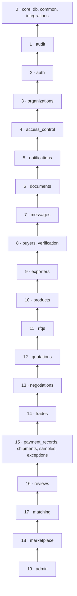

# Frontières des modules — backend MadaSource

Jour 2 · 2026-10-12 · Statut : proposition à valider (décisions D-05, D-06, D-07 de [architecture.md](architecture.md#12-registre-des-décisions))

## 1. Principes

1. Un module = un domaine métier, avec ses tables, ses règles et ses endpoints (RJ section 2).
2. Un module n'utilise un autre module **que par son interface publique** : fonctions de service exportées et schémas exportés. Jamais ses modèles, son repository ni ses fonctions internes (CLAUDE.md).
3. Les dépendances forment un **graphe sans cycle**, organisé en niveaux : un module ne dépend que de modules de niveau strictement inférieur (section 3).
4. Quand un module de niveau inférieur doit déclencher un traitement d'un module supérieur, il passe par un **port** (section 5), jamais par un import direct.
5. Les modules sont créés au jour de leur implémentation, sans fichier vide anticipé (RJ section 2).

## 2. Catalogue des modules

Les entités sont indicatives : le modèle de données est l'objet du Jour 3.

| Module | Niveau | Responsabilité | Entités possédées (proposé) | Jours |
|---|---|---|---|---|
| `audit` | 1 | Journal d'audit en ajout seul : écriture interne, lecture admin | AuditLog | 12 |
| `auth` | 2 | Utilisateurs et identifiants : mots de passe, jetons d'accès, de rafraîchissement, de vérification d'email et de réinitialisation | User, RefreshToken, EmailVerificationToken, PasswordResetToken | 8, 10, 11 |
| `organizations` | 3 | Organisations (type, statut) et adhésions des utilisateurs | Organization, OrganizationMembership | 9 |
| `access_control` | 4 | Rôles et permissions, résolution de l'acteur courant, contrôles de permission, registre d'accès par contexte (port P-01) | Role, Permission, RolePermission | 9 |
| `notifications` | 5 | Notifications in-app : création, liste, lecture. Préparation email et push | Notification (outbox au Jour 31) | 31 |
| `documents` | 6 | Coffre documentaire : métadonnées, versions, stockage via `integrations`, accès selon le contexte | Document, DocumentVersion | 29 |
| `messages` | 7 | Conversations rattachées à un contexte, messages | Conversation, Message | 30 |
| `buyers` | 8 | Profil et statut du compte acheteur, orchestration de l'inscription acheteur, favoris si retenus (Q-63) | BuyerProfile | 13 |
| `verification` | 8 | Enregistrements de vérification, niveaux, décisions admin, expiration | VerificationRecord | 15 |
| `exporters` | 9 | Profil exportateur public et privé, onboarding, capacités, certifications déclarées, identifiant public du Passport | ExporterProfile, CapacityRecord | 14 |
| `products` | 10 | Catégories (feature flags), attributs par catégorie, catalogue des exportateurs, publication | ProductCategory, CategoryAttribute, Product, ProductAttributeValue | 16, 17 |
| `rfqs` | 11 | RFQ, lignes, machine d'état, destinataires et inbox exportateur (Respond, Decline, Ask Question) | RFQ, RFQItem, RFQRecipient | 19 à 21 |
| `quotations` | 12 | Quotations, lignes, règles de prix configurables, coûts externes et leurs sources, validité | Quotation, QuotationLine, PricingRule, ExternalCost | 24, 25 |
| `negotiations` | 13 | Négociations et propositions immuables, acceptation (qui déclenche la création du Trade via P-02) | Negotiation, NegotiationOffer | 26, 27 |
| `trades` | 14 | Trade, Trade ID, termes figés, machine d'état, TradeEvent, tableau de bord agrégé | Trade, TradeItem, TradeEvent | 27, 28 |
| `payment_records` | 15 | Enregistrements de paiement, confirmation admin, effet sur le statut du Trade | PaymentRecord | 33 |
| `shipments` | 15 | Expéditions manuelles, historique de suivi, effet sur le statut du Trade | Shipment, TrackingEvent | 34 |
| `samples` | 15 | Demandes d'échantillons et leur workflow (flag proposé, Q-53) | SampleRequest | 32 |
| `exceptions` | 15 | Centre d'exceptions et litiges | ExceptionCase, Dispute | 35 |
| `reviews` | 16 | Avis réciproques, indicateurs de performance calculés sur données réelles | Review, ReviewRating | 35 |
| `matching` | 17 | Moteur déterministe, pondérations versionnées, exécutions et résultats expliqués | MatchingConfig, MatchRun, RFQMatch | 22, 23 |
| `marketplace` | 18 | Lecture publique : recherche catalogue, profils publics, Digital Exporter Passport, QR code | Aucune table (lecture seule) | 18 |
| `admin` | 19 | Tableau de bord et analytique transverses (Q-62), consultation des paramètres et des flags | Aucune, ou paramètres | 35 |

Socle (niveau 0), sans règle métier : `core` (configuration, journalisation, primitives de sécurité, exceptions, feature flags), `db` (base déclarative, session, conventions de nommage), `common` (Money, Quantity, pagination, horloge, identifiants, schémas de base), `integrations` (interfaces et adaptateurs externes, D-21).

Remarques de nommage :
- Le modèle du module `exceptions` ne doit pas s'appeler `Exception`, qui masquerait l'exception intégrée de Python : propositions `ExceptionCase` et `Dispute`.
- Le nom du module lui-même peut prêter à confusion avec `app/core/exceptions.py`. Un renommage en `incidents` est possible, mais il s'écarterait de la roadmap (RJ section 2) : à décider au Jour 35.

## 3. Niveaux et dépendances permises

Un module peut dépendre :
- du socle (niveau 0) ;
- de l'interface publique de tout module de **niveau strictement inférieur**.

Deux modules d'un même niveau sont **indépendants** l'un de l'autre.

Chaque flèche signifie « peut utiliser les niveaux inférieurs ». Dépendances effectivement attendues :

| Module | Utilise (interface publique) | Raison |
|---|---|---|
| `auth` | audit, integrations (email) | Audit des connexions ; envoi des emails de vérification et de réinitialisation |
| `organizations` | auth, audit | Adhésion d'un utilisateur existant |
| `access_control` | organizations, auth, audit | Construction de l'acteur : utilisateur, organisation, rôles, permissions |
| `notifications` | organizations, auth | Destinataires : membres d'une organisation |
| `documents` | access_control (P-01), notifications, audit, integrations (stockage) | Accès selon le contexte, avis de dépôt |
| `messages` | documents, access_control (P-01), notifications, audit | Pièces jointes, participants |
| `buyers` | auth, organizations, access_control, audit | Inscription et profil acheteur |
| `verification` | organizations, documents, notifications, audit | Documents examinés, décision notifiée |
| `exporters` | verification, documents, organizations, access_control, audit | Statut de vérification du profil, documents d'onboarding |
| `products` | exporters, verification, documents, audit, core (flags) | Propriétaire exportateur, conditions de publication (Q-16) |
| `rfqs` | buyers, products, documents, messages, notifications, audit | Catégories et produits demandés, questions des exportateurs |
| `quotations` | rfqs, exporters, products, notifications, audit | Réponse à une RFQ adressée, prix et validité |
| `negotiations` | quotations, rfqs, notifications, audit | Propositions sur une quotation, statut Negotiating de la RFQ |
| `trades` | negotiations, quotations, rfqs, organizations, documents, messages, notifications, audit | Création à l'acceptation, termes figés, agrégation |
| `payment_records` | trades, documents, notifications, audit | Justificatifs, transition Payment Confirmed |
| `shipments` | trades, documents, notifications, audit | Transitions Shipped à Delivered |
| `samples` | products, rfqs, buyers, exporters, documents, messages, notifications, audit | Workflow d'échantillon (Q-53) |
| `exceptions` | trades, quotations, rfqs, documents, notifications, audit | Litiges (statut Disputed), exceptions avant Trade (SRC-19) |
| `reviews` | trades, exceptions, quotations, rfqs, organizations, audit | Avis après Completed, indicateurs (réponse, litiges) |
| `matching` | rfqs, exporters, products, verification, reviews (si Q-32), notifications, audit | Critères et indicateurs, envoi aux exportateurs |
| `marketplace` | products, exporters, verification, reviews | Projections publiques |
| `admin` | lecture de tous les modules | Analytique transverse (Q-62) |

Si Q-53 décide que les échantillons utilisent les Payment Records ou les expéditions, `samples` passe au niveau 16 pour pouvoir en dépendre.

## 4. Couche HTTP

- Rien n'importe un `router.py`, sauf `app/api/v1/router.py`, qui assemble les routers des modules actifs.
- Le router d'un module n'appelle que le service de son propre module. Il utilise aussi les **dépendances FastAPI d'`access_control`** (acteur courant, `require_permission`), quel que soit le niveau du module.
  - Exemple : le router d'`organizations` (niveau 3) utilise ces dépendances (niveau 4).
  - Il n'y a pas de cycle : les services n'importent jamais de router.
- Un module peut déclarer des sous-ressources sous le chemin d'une ressource d'un module **inférieur**. Par exemple, `negotiations` déclare `/quotes/{quote_id}/negotiation` (voir [api-conventions.md](api-conventions.md#3-carte-des-domaines-de-lapi)). L'inverse est interdit.
- Les endpoints d'administration d'un domaine appartiennent au module de ce domaine, montés sous `/api/v1/admin/<domaine>`, avec des permissions admin explicites. Le module `admin` ne contient que les vues transverses : pas de « module dieu » qui manipulerait les internes des autres.

## 5. Communication sans imports circulaires

Trois mécanismes, par ordre de préférence :

### 5.1 Appel descendant (par défaut)

Le module A appelle une fonction publique du service de B, de niveau inférieur, en lui passant la session et l'acteur. B ne valide pas la transaction (D-08).
Exemple : `quotations` appelle `rfqs` pour vérifier que l'exportateur est destinataire de la RFQ, puis pour passer la RFQ en « Quotations Received ».

### 5.2 Port (appel montant nécessaire)

Le module inférieur **déclare une interface** (Protocol Python) dans son fichier `ports.py`. Le module supérieur l'**implémente**. La composition root (`app/wiring.py`, appelée par l'application factory) branche l'implémentation au démarrage.

L'appel reste synchrone, explicite, dans la même session et la même transaction. Le module inférieur ne connaît que son interface.

| Port | Déclaré par | Implémenté par | Usage |
|---|---|---|---|
| P-01 `ContextAccessRegistry` | `access_control` | `rfqs`, `quotations`, `negotiations`, `trades`, `shipments`, `samples` | « Cet acteur peut-il voir ou écrire dans le contexte (type, id) ? » Utilisé par `documents` et `messages` pour les documents et conversations rattachés à une RFQ, une quotation, une négociation, un Trade, une expédition ou un échantillon. Le contexte « organisation » est traité directement par `access_control`. |
| P-02 `TradeCreationPort` | `negotiations` | `trades` | À l'acceptation, créer le Trade dans la même transaction (BR-TRD-01 à BR-TRD-03) et renvoyer sa référence. |
| P-03 `RFQSubmissionHook` | `rfqs` | `matching` | À la soumission, lancer le matching dans la même transaction (RJ 23). |
| P-04 `TradeSectionProvider` | `trades` | `payment_records`, `shipments`, `exceptions` | Fournir les sections du tableau de bord d'un Trade (paiements, expéditions, litiges). |
| P-05 `TradeTransitionGuard` | `trades` | `payment_records`, `shipments` | Autoriser ou refuser une transition selon des conditions détenues par un module supérieur, par exemple pas de Completed sans paiement confirmé (Q-41, Q-42). |

Règles des ports :
- **Refus par défaut** : si aucune implémentation n'est branchée pour un type de contexte (module désactivé par un flag), l'accès est refusé (P-01) ou l'action indisponible.
- Une implémentation de port ne valide jamais la transaction. Elle renvoie des données simples (identifiants, références, structures de `common` ou du module déclarant), jamais un modèle ORM.
- Liste fermée : un nouveau port est une décision d'architecture, documentée ici.

### 5.3 Pas de bus d'événements en V1

Audit et notifications sont des modules de bas niveau, appelés **directement** par le cas d'usage, dans sa transaction. Avantages :
- l'audit et la notification in-app sont garantis cohérents avec l'action (BR-AUD-01) ;
- le flux reste lisible.

Un bus d'événements (publication et abonnement) n'est introduit que si un besoin apparaît, par exemple plusieurs réactions indépendantes à un même événement. Les effets externes (email) passent par l'outbox (D-20).

## 6. Données et base de données entre modules

| Règle | Statut |
|---|---|
| Chaque table appartient à un seul module, qui est le seul à y écrire. | Proposé (D-07) |
| Une clé étrangère vers la table d'un module **inférieur** est autorisée, déclarée par le nom de table (`ForeignKey("rfqs.id")`) sans importer le modèle Python de l'autre module. | Proposé (D-07) |
| Aucune `relationship()` SQLAlchemy entre deux modules. La navigation passe par les identifiants et les services. | Proposé (D-07) |
| Références polymorphes (type et identifiant de contexte) pour `documents`, `messages`, `audit` et `notifications`, sans clé étrangère. L'intégrité est garantie par le service et par P-01. | Proposé |
| **Exception de lecture** : les modules de lecture (`marketplace`, `admin`, et les requêtes d'indicateurs de `reviews` et `matching`) peuvent faire des requêtes SQL en **lecture seule** joignant les tables de modules inférieurs, dans leur propre repository. Ils n'y écrivent jamais. | Proposé |
| Un seul historique Alembic. Tous les modèles sont enregistrés dans la base déclarative commune pour l'autogénération (Jour 6). | Retenu (D-01) |

## 7. Le noyau partagé (`common`)

`common` contient :
- les types valeur Money et Quantity ;
- les schémas de pagination et de liste ;
- l'horloge injectable ;
- la génération d'identifiants ;
- les types d'erreurs de base (ou leur réexport depuis `core`) ;
- les petites structures échangées par les ports.

`common` ne contient **aucune règle métier** : pas de calcul de prix, pas de machine d'état, pas de permission. Un élément métier partagé appartient au module de plus bas niveau qui en a besoin.

## 8. Exemples de flux

**Soumission d'une RFQ :**
1. Le router de `rfqs` appelle `rfqs.submit`.
2. `rfqs.submit` verrouille la RFQ, contrôle les champs obligatoires, la passe de Draft à Submitted et écrit l'audit.
3. Il appelle le port P-03, implémenté par `matching`.
4. `matching` lit les exportateurs, produits et vérifications, puis enregistre les résultats.
5. `matching` appelle `rfqs` (descendant) pour passer la RFQ à Matching, puis à Sent to Exporters si l'envoi est automatique (Q-31), et pour créer les destinataires.
6. Chaque destinataire est notifié.
7. Commit unique.

**Acceptation d'une proposition :**
1. Le router de `negotiations` appelle `negotiations.accept`.
2. Le cas d'usage verrouille dans l'ordre : RFQ, via `rfqs` ; quotation, via `quotations` ; négociation.
3. Il vérifie la validité (BR-QUO-05, BR-NEG-03) et marque la proposition acceptée.
4. Il appelle le port P-02, implémenté par `trades`, qui :
   - copie les termes ;
   - incrémente le compteur `MST` ;
   - crée le premier TradeEvent ;
   - passe la RFQ en Accepted via `rfqs` ;
   - notifie les parties ;
   - écrit l'audit.
5. Commit unique.
6. La réponse contient la référence du Trade.

**Téléchargement d'un document de Trade :**
1. Le router de `documents` appelle `documents.get_download`.
2. Le contexte du document est (trade, id). P-01 interroge l'implémentation de `trades` : l'organisation de l'acteur est-elle partie au Trade ?
3. Si oui, une URL signée à durée limitée est produite via `integrations` (stockage).
4. Le téléchargement est audité selon la catégorie du document.

**Confirmation d'un paiement :**
1. Le router admin de `payment_records` appelle `payment_records.confirm`.
2. Le cas d'usage verrouille le Trade (via `trades`), puis le Payment Record.
3. Il fait passer le Payment Record à Confirmed.
4. `trades.transition` fait passer le Trade de Payment Pending à Payment Confirmed, après les contrôles P-05.
5. Audit, notifications, commit unique.

## 9. Contrôle automatique

| Contrôle | Moment | Statut |
|---|---|---|
| Contrats d'imports vérifiés en CI avec `import-linter` : couches (section 3), indépendance des modules d'un même niveau, interdiction d'importer un router hors de `api/v1/router.py`. Dépendance à justifier au Jour 7. | Jour 7 | Proposé |
| Liste de contrôle de la revue (`code-review-madasource`) : accès aux internes d'un autre module, `relationship()` inter-modules, commit dans une fonction appelée par un autre module. | Dès le Jour 5 | Proposé |
| Test de démarrage : chaque port déclaré a une implémentation branchée pour les modules actifs. | Dès le premier port | Proposé |

## 10. Décisions ouvertes

- Niveau de `samples` selon Q-53 (section 3).
- Nom du module `exceptions` (section 2).
- Inclusion de la performance historique dans `matching` (Q-32), qui crée ou non la dépendance `matching` → `reviews`.
- Favoris dans `buyers` si Q-63 les retient.
