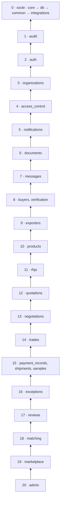

# Frontières des modules — backend MadaSource

Jour 2 · 2026-10-12 · Statut : proposition à valider (décisions D-05, D-06, D-07, D-28 à D-33 de [architecture.md](architecture.md#12-registre-des-décisions)). Révisée après la revue `backend-architect` et la revue finale du Jour 2.

## 1. Principes

1. Un module = un domaine métier, avec ses tables, ses règles et ses endpoints (RJ section 2).
2. Un module n'utilise un autre module **que par son interface publique** :
   - les fonctions de service exportées, qui renvoient des **DTO immuables** déclarés dans `contracts.py` ;
   - et, pour les lectures publiques ou transverses, les **projections** de `projections.py` (section 6).

   Jamais ses modèles, son repository, ses schémas HTTP ni ses fonctions internes (D-31).
3. Les dépendances forment un **graphe sans cycle**, organisé en niveaux. Un module ne dépend que de modules de niveau strictement inférieur (section 3).
4. **Un cas d'usage qui touche plusieurs modules appartient au module de plus haut niveau concerné** : il orchestre les autres par des appels descendants (D-33).
5. Un appel montant n'est possible que par l'un des deux ports déclarés (section 5.2).
6. Les modules sont créés au jour de leur implémentation, sans fichier vide anticipé (RJ section 2). Quand un module de bas niveau est construit après des modules qui l'utilisent, la section 11 fixe la stratégie : rétro-branchement ou noyau minimal anticipé (Q-93).

## 2. Catalogue des modules

Les entités sont indicatives : le modèle de données est l'objet du Jour 3.

| Module | Niveau | Responsabilité | Entités possédées (proposé) | Jours |
|---|---|---|---|---|
| `audit` | 1 | Journal d'audit en ajout seul : écriture interne, lecture admin. Références par identifiants, sans clé étrangère. Fonction d'écriture **hors transaction principale** pour les événements de sécurité (D-29). | AuditLog | 12 |
| `auth` | 2 | Utilisateurs et identifiants ; états propres à l'utilisateur (email vérifié, compte désactivé) ; jetons ; sessions (avec indicateur de second facteur vérifié, S-09). Révocation de session et compteurs d'échecs **hors transaction principale** (D-29). Emails via l'outbox du socle (D-20). | User, Session, RefreshToken, EmailVerificationToken, PasswordResetToken | 8, 9, 10, 11 |
| `organizations` | 3 | Organisations : type ; **statut de compte** (statuts acheteur du CdC §10 : Pending, Active, Suspended, Blocked ; statuts exportateur : Q-12) (D-28) ; adhésions | Organization, OrganizationMembership | 9, 11 |
| `access_control` | 4 | Rôles, permissions, **attribution des rôles aux adhésions** ; gestion des membres par l'organisation (Q-10) ; construction de l'acteur (type `Actor` de `common`), y compris l'exigence de second facteur pour les permissions admin (S-09) ; politique d'accès commune ; registre P-01 | Role, Permission, RolePermission, MembershipRole | 9 |
| `notifications` | 5 | Notifications in-app : création, liste, lecture. Ne stocke que le type, la référence et le destinataire (S-52). | Notification | 31 |
| `documents` | 6 | Coffre documentaire : métadonnées, versions et leur audience (S-24), stockage via le socle, accès via P-01 | Document, DocumentVersion | 29 (noyau minimal possible plus tôt : Q-93) |
| `messages` | 7 | Conversations à participants explicites, rattachées à un contexte ; messages (S-46) | Conversation, ConversationParticipant, Message | 30 |
| `buyers` | 8 | Profil acheteur (produits d'intérêt en codes de catégories, D-30) ; orchestration de l'inscription et des décisions de statut via `organizations` (D-28) | BuyerProfile | 13 |
| `verification` | 8 | Enregistrements de vérification d'une organisation exportatrice (référence `organizations.id`, C11) ; décisions ; expiration calculée à la lecture | VerificationRecord | 15 |
| `exporters` | 9 | Profil exportateur public et privé ; inscription ; capacités (codes de catégories) ; coordonnées bancaires de l'exportateur (S-22, S-44) ; slug du Passport. Orchestre les décisions admin qui changent l'état de l'exportateur (CdC §36, C11). **Seul point de modification** des champs couverts par une vérification, comme la raison sociale ou l'immatriculation (S-53). | ExporterProfile, CapacityRecord, BankDetails | 14, 15 |
| `products` | 10 | Métadonnées des catégories (libellés, attributs, liaison aux flags, D-30) ; catalogue ; publication ; projections publiques (section 6) | CategoryDefinition, CategoryAttribute, Product, ProductAttributeValue | 16, 17 |
| `rfqs` | 11 | RFQ, lignes, machine d'état ; destinataires et inbox ; actions **Decline** et **Ask Question**, avec questions et réponses stockées par paire (RFQ, exportateur) (S-31) ; port P-03 | RFQ, RFQItem, RFQRecipient, RFQQuestion | 19 à 21 |
| `quotations` | 12 | Quotations versionnées (S-43), lignes, règles de prix versionnées, coûts externes et leurs sources ; action **Respond**, qui crée une quotation (C5) ; taux de change si Q-65 | Quotation, QuotationVersion, QuotationLine, PricingRule, ExternalCost | 21, 24, 25 |
| `negotiations` | 13 | Négociations et propositions immuables ; association proposition–coûts externes ; fonction interne d'acceptation, appelée par `trades` | Negotiation, NegotiationOffer, OfferExternalCost | 26 |
| `trades` | 14 | Trade : deux jeux de termes (S-39), statuts résumés de paiement et d'expédition, machine d'état, TradeEvent. **Orchestration de l'acceptation** (D-33). | Trade, TradeTerms, TradeItem, TradeEvent | 27, 28 |
| `payment_records` | 15 | Paiements enregistrés et orientés (S-40) ; confirmation admin avec séparation des tâches (S-34) ; **comptes de réception de MadaSource** (coordonnées bancaires de MadaSource, régime S-44) ; mise à jour du Trade par appel descendant | PaymentRecord, ReceivingAccount | 33 |
| `shipments` | 15 | Expéditions manuelles, historique de suivi ; mise à jour du Trade par appel descendant | Shipment, TrackingEvent | 34 |
| `samples` | 15 | Demandes d'échantillons et leur workflow (flag proposé, Q-53) | SampleRequest | 32 |
| `exceptions` | 16 | Centre d'exceptions et litiges (dont retards de paiement et d'expédition) | ExceptionCase, Dispute | 35 |
| `reviews` | 17 | Avis réciproques ; indicateurs de performance calculés sur données réelles, y compris ceux des acheteurs (dont la fiabilité de paiement, CdC §44) | Review, ReviewRating | 35 |
| `matching` | 18 | Moteur déterministe ; pondérations versionnées ; exécutions et résultats expliqués ; implémente P-03 | MatchingConfig, MatchRun, RFQMatch | 22, 23 |
| `marketplace` | 19 | Lecture publique : recherche du catalogue, profils publics, Passport, QR code, avis publics | Aucune table (projections publiées) | 18 |
| `admin` | 20 | Tableau de bord et analytique transverses (Q-62) ; consultation des paramètres et des flags ; **orchestration des interventions admin qui doivent notifier** : actions « pour le compte de » une organisation (S-32), création et promotion d'administrateurs (S-08) | Aucune, ou paramètres | 35 (interventions : au jour des modules concernés) |

**Socle (niveau 0)**, ordre interne `core` → `db` → `common` → `integrations`. Il ne contient aucune règle métier :
- `core` : configuration, journalisation, primitives de sécurité, exceptions, feature flags, codes de catégories ;
- `db` : base déclarative, session, nommage, tables techniques (compteurs D-16), outil d'unité de travail séparée (D-29) ;
- `common` : Money, Quantity, Clock, Actor, pagination, codes de référence ;
- `integrations` : stockage, email, outbox (D-20).

Remarques :
- **Favoris** (si Q-63 les retient) : ils portent sur des produits (niveau 10), des exportateurs (9) et des quotations (12). Ils forment donc un petit module `favorites` de niveau 13 ou plus, et non une partie de `buyers`, ce qui créerait des clés étrangères montantes.
- Le modèle du module `exceptions` ne s'appelle pas `Exception`, qui masquerait l'exception intégrée de Python : propositions `ExceptionCase` et `Dispute`. Un renommage du module en `incidents` reste possible au Jour 35.
- Le Jour 21 (inbox exportateur) s'appuie sur `rfqs` pour Decline et Ask Question, et sur `quotations` pour Respond.

## 3. Niveaux et dépendances permises

Un module peut dépendre :
- du socle ;
- de l'interface publique de tout module de **niveau strictement inférieur**.

Deux modules d'un même niveau sont **indépendants** l'un de l'autre.

Dépendances attendues :

| Module | Utilise (interface publique) | Raison |
|---|---|---|
| `auth` | audit ; socle (outbox d'email, unité de travail séparée) | Audit des connexions, emails de vérification et de réinitialisation |
| `organizations` | auth, audit | Adhésion d'un utilisateur existant, statut de compte |
| `access_control` | organizations, auth, audit | Acteur construit à partir du statut de compte et des rôles **courants** ; gestion des membres |
| `notifications` | access_control, organizations, auth | Destinataires : membres d'une organisation, admins par ensemble de permissions |
| `documents` | access_control (P-01), notifications, audit ; socle (stockage) | Audience par contexte (P-01) et par document |
| `messages` | documents, access_control (P-01), notifications, audit | Pièces jointes, participants |
| `buyers` | auth, organizations, access_control, notifications, audit | Inscription, profil, décisions de statut |
| `verification` | organizations, documents, notifications, audit | Documents examinés, décisions notifiées |
| `exporters` | verification, auth, organizations, access_control, documents, notifications, audit | Inscription, statut de vérification, re-vérification des coordonnées bancaires et des champs vérifiés (S-44, S-53) |
| `products` | exporters, verification, organizations, documents, audit ; socle (flags) | Propriétaire, conditions de publication (Q-16) |
| `rfqs` | buyers, products, documents, messages, notifications, audit | Produits demandés, questions des exportateurs |
| `quotations` | rfqs, exporters, products, notifications, audit | Respond, prix versionnés, validité |
| `negotiations` | quotations, rfqs, notifications, audit | Propositions, statut Negotiating de la RFQ |
| `trades` | negotiations, quotations, rfqs, organizations, documents, messages, notifications, audit | Acceptation, termes figés, Trade |
| `payment_records`, `shipments` | trades, documents, notifications, audit | Justificatifs ; transitions du Trade par fonctions nommées |
| `samples` | products, rfqs, buyers, exporters, documents, messages, notifications, audit | Workflow d'échantillon (Q-53) |
| `exceptions` | payment_records, shipments, trades, quotations, rfqs, documents, notifications, audit | Retards et litiges (Disputed, On Hold) |
| `reviews` | exceptions, payment_records, trades, quotations, rfqs, organizations, audit | Avis après Completed ; indicateurs, dont la fiabilité de paiement (CdC §44). Sert aussi `/buyers/me/indicators`. |
| `matching` | reviews (si Q-32), rfqs, exporters, products, verification, notifications, audit | Critères ; sert le score d'une RFQ dans l'inbox (`/rfq-inbox/{rfq_id}/match`, selon Q-31) |
| `marketplace` | projections de reviews, products, exporters, verification | Lecture publique |
| `admin` | tous les modules (services et projections) | Analytique transverse (Q-62) ; interventions admin qui notifient (S-32, S-08) |

Si Q-53 décide que les échantillons utilisent les Payment Records ou les expéditions, `samples` passe au niveau 16.

## 4. Couche HTTP

- Rien n'importe un `router.py` ou un fichier de `app/api/`, sauf `app/api/v1/router.py`.
- Les routers des modules de niveau 1 à 3 (`audit`, `auth`, `organizations`) sont placés dans la **couche HTTP**, `app/api/v1/endpoints/`, prévue par RJ section 2 au-dessus des modules. Ils peuvent ainsi utiliser les dépendances FastAPI d'`access_control` (acteur courant, `require_permission`) sans import montant : aucune exception au contrôle automatique n'est nécessaire (section 9). Les modules de niveau 4 et plus gardent leur `router.py`, qui importe `access_control` vers le bas.
- Le router d'un module n'appelle que le service de son module.
- Un module peut déclarer des sous-ressources sous le chemin d'une ressource d'un module **inférieur**. Exemples :
  - `quotations` déclare `/rfq-inbox/{rfq_id}/quotes` ;
  - `trades` déclare `/quotes/{quote_id}/accept` ;
  - `reviews` déclare `/buyers/me/indicators` ;
  - `access_control` déclare `/organizations/current/members`.

  L'inverse est interdit ([api-conventions.md](api-conventions.md#3-carte-des-domaines-de-lapi)).
- Les endpoints d'administration d'un domaine appartiennent au module du domaine (`/api/v1/admin/<domaine>`). Exception, par la règle D-33 : une intervention admin qui doit **notifier** une organisation ou d'autres admins est orchestrée par `admin`. Cela concerne l'action « pour le compte de » (S-32) et la création ou promotion d'un administrateur (S-08).
- Le router instancie explicitement le schéma de l'audience retournée par la politique d'accès. Jamais d'union de schémas résolue automatiquement (D-32).

## 5. Communication sans imports circulaires

### 5.1 Appel descendant (par défaut)

Le module A appelle une fonction publique du service de B, de niveau inférieur, en lui passant la session et l'acteur. B ne valide pas la transaction et renvoie un DTO (D-08, D-31).
Exemple : `quotations` appelle `rfqs` pour verrouiller la RFQ, vérifier le destinataire et le passer en Responded.

### 5.2 Ports (deux seulement)

Le module inférieur déclare une interface (Protocol Python) dans `ports.py` ; le module supérieur l'implémente ; `app/wiring.py` branche les implémentations au démarrage. L'appel est synchrone, dans la même session et la même transaction. L'implémentation ne valide jamais et renvoie des DTO.

**P-01 `ContextAccessRegistry`**, déclaré par `access_control`. Contrat :
- `resolve(acteur, contexte, action) → audience ou refus`, où l'action vaut lire, écrire, rattacher ou partager (S-14, S-29) ;
- `participants(contexte) → liste de (organisation, audience)`, pour notifier les bonnes organisations et vérifier l'audience d'un document (S-24).

| Type de contexte | Implémenté par |
|---|---|
| `organization` (documents de société, d'onboarding) | `access_control` lui-même |
| `verification_record` (documents examinés) | `verification` |
| `product` (images, documents de produit) | `products` |
| `rfq`, `rfq_recipient` (paire RFQ–exportateur, S-31) | `rfqs` |
| `quotation` | `quotations` |
| `negotiation` | `negotiations` |
| `trade`, `trade_event` | `trades` |
| `payment_record` | `payment_records` |
| `shipment` | `shipments` |
| `sample_request` | `samples` |
| `conversation` (pièces jointes) | `messages` |
| `exception_case`, `dispute` (preuves) | `exceptions` |

Utilisé par `documents` et `messages`. **Par défaut, refus** : un type de contexte sans implémentation branchée est inaccessible (module désactivé ou pas encore développé).

**P-03 `RFQSubmissionHook`**, déclaré par `rfqs`, implémenté par `matching`.
- Contrat : `on_submitted(session, rfq) → sélection`, où `rfq` est un DTO complet de la RFQ soumise (lignes, destination, Incoterm, exigences). `matching` n'a donc pas à relire `rfqs`. La sélection contient les exportateurs retenus, leurs scores et leurs raisons.
- `rfqs` applique lui-même les transitions et crée les destinataires : il n'y a pas de réentrance.
- **Par défaut**, tant que `matching` n'existe pas (Jours 19 à 21) : sans effet, la RFQ reste Submitted.
- Un échec du matching est isolé par un point de sauvegarde : la soumission reste valide et la RFQ reste Submitted. À valider avec Q-24 et Q-31.

**Ports retirés après la revue** (C35) :

| Ancien port | Remplacement |
|---|---|
| P-02 (création du Trade à l'acceptation) | `trades` orchestre l'acceptation (D-33). Au Jour 26, `negotiations` fournit la fonction interne d'acceptation, testée au niveau service ; la route arrive au Jour 27 avec `trades`. |
| P-04 (sections du tableau de bord) | Le Trade porte des statuts résumés de paiement et d'expédition (CdC §23), mis à jour par appel descendant. Le détail se lit sur `/trades/{id}/payments` et `/trades/{id}/shipments`. |
| P-05 (gardes de transition) | `trades` expose des fonctions nommées (par exemple `mark_payment_confirmed`), appelées par `payment_records` et `shipments`, et non exposées par l'endpoint générique de transitions. Les conditions de Completed portent sur les statuts résumés du Trade (Q-42). |

Registres :
- le registre P-01 est dans `access_control`, l'emplacement P-03 dans `rfqs` ;
- `wiring.py` les remplit ;
- les tests peuvent les réinitialiser ou les remplacer par des fixtures ;
- un nouveau port est une décision d'architecture, documentée ici.

### 5.3 Pas de bus d'événements en V1

Audit et notifications sont appelés **directement** par le cas d'usage, dans sa transaction (BR-AUD-01).
- Une notification ne stocke que son type, la référence de l'objet et ses destinataires.
- Le client lit l'objet par l'endpoint du module qui le possède, avec les droits courants (S-52).
- `notifications` filtre seulement sur l'adhésion courante.

Un rendu côté serveur demanderait un port supplémentaire, à créer seulement si le besoin apparaît (nouvelle décision d'architecture). Les effets externes passent par l'outbox du socle, envoyée après validation (D-20).

## 6. Données et base de données entre modules

| Règle | Statut |
|---|---|
| Chaque table appartient à un seul module, qui est le seul à y écrire. Les tables techniques (compteurs, outbox) appartiennent au socle. | Proposé (D-07, D-30) |
| Une clé étrangère n'est autorisée que vers la table d'un module **inférieur** (ou du socle), déclarée par le nom de table, sans import du modèle Python. Corrections du modèle conceptuel du Jour 1 (C11, C12, C13) : - VerificationRecord référence l'organisation ; - l'attribution des rôles appartient à `access_control` ; - l'association proposition–coûts externes appartient à `negotiations` ; - l'audit ne garde que des identifiants ; - les catégories sont référencées par code en dessous de `products` ; - les favoris éventuels forment leur propre module (section 2). | Proposé (D-07) |
| Aucune `relationship()` SQLAlchemy entre deux modules. | Proposé (D-07) |
| Références polymorphes (type et identifiant de contexte) pour `documents`, `messages`, `audit` et `notifications`, sans clé étrangère. L'intégrité est garantie par le service et par P-01. | Proposé |
| **Projections publiées** (constat E-8 de la relecture de sécurité et C8). Pour ses lectures publiques ou transverses, chaque module publie dans `projections.py` des fonctions qui renvoient une requête SQL (`Select`) limitée aux colonnes et conditions autorisées. Exemple : `products.public_listing_select()` : produits publiés, organisation active, vérification valide, colonnes publiques seulement. `marketplace` et `admin` composent ces projections (filtres, tri, pagination en base), sans importer les modèles d'un autre module ni réécrire ses règles de visibilité. **Exception déclarée à D-31** : une projection renvoie une requête et non un DTO, pour que filtres et pagination restent en base. | Proposé |
| Un seul historique Alembic ; tous les modèles sont enregistrés dans la base déclarative commune (Jour 6). | Retenu (D-01) |

## 7. Le noyau partagé

`common` contient :
- les types valeur Money et Quantity ;
- l'horloge ;
- la pagination ;
- les identifiants ;
- les codes de référence : pays, devises, Incoterms (D-30) ;
- le **type Actor**, construit par `access_control` et utilisable par tous les modules, y compris `audit`, `auth` et `organizations` (D-31). Il porte l'utilisateur, l'organisation, le statut, les permissions, la session (avec l'indicateur de second facteur), l'instant d'authentification, l'acteur Système (S-58) et les interventions « pour le compte de » (S-32).

`common` ne contient **aucune règle métier** : pas de calcul de prix, pas de machine d'état, pas de permission.

## 8. Exemples de flux

Chaque cas d'usage verrouille selon D-09 : `FOR NO KEY UPDATE` avec `populate_existing`, ordre croissant des niveaux, parent avant toute insertion fille.

**Soumission d'une RFQ** (`rfqs`) :
1. Verrouiller la RFQ.
2. Contrôler les champs, passer de Draft à Submitted, écrire l'audit.
3. Appeler P-03 avec le DTO de la RFQ. `matching` calcule dans un point de sauvegarde et renvoie sa sélection.
4. `rfqs` passe la RFQ à Matching, puis à Sent to Exporters si l'envoi est automatique (Q-31). Il crée les destinataires et les notifie.
5. Commit unique.

**Respond : création d'une quotation** (`quotations`, `POST /rfq-inbox/{rfq_id}/quotes`) :
1. Verrouiller la RFQ via `rfqs`, **avant** d'insérer la quotation.
2. Vérifier que le destinataire est actif (S-30).
3. Créer la quotation (version 1, prix calculé et stocké, S-43).
4. `rfqs` passe le destinataire en Responded, et la RFQ en Quotations Received s'il s'agit de la première quotation.
5. Notifier l'acheteur, puis commit.

**Acceptation** (`trades`, chemin unique `POST /quotes/{quote_id}/accept`, avec la référence et la version de la proposition vue) :
1. Verrouiller dans l'ordre : RFQ, quotation, négociation, via leurs modules.
2. Vérifier la version (S-43) et la validité (BR-QUO-05).
3. `negotiations` marque la proposition acceptée.
4. Créer le Trade avec ses deux jeux de termes (S-39). Le compteur `MST` est pris en dernier.
5. Écrire le TradeEvent, passer la RFQ en Accepted, notifier, écrire l'audit.
6. Commit. Réponse 200 avec l'identifiant et la référence du Trade ; un rejeu renvoie la même réponse (D-09, D-33).

**Téléchargement d'un document de Trade** (`documents`) :
1. `P-01.resolve(acteur, (trade, id), lire)` donne l'audience de l'acteur.
2. Contrôler que l'audience de la version du document l'inclut (S-24).
3. Produire une URL signée de courte durée, puis auditer le téléchargement.

**Confirmation d'un paiement** (`payment_records`, route admin) :
1. Verrouiller le Trade via `trades`, puis le Payment Record.
2. Vérifier la ré-authentification (S-35) et que le confirmateur n'est pas l'auteur de la saisie (S-34).
3. Passer le Payment Record à Confirmed.
4. `trades.mark_payment_confirmed` met à jour le statut résumé et fait passer le Trade de Payment Pending à Payment Confirmed.
5. Audit, notifications, commit.

**Rejeu d'un jeton de rafraîchissement** (`auth`, D-29) :
1. Le jeton présenté est déjà consommé : le cas d'usage enregistre l'effet « révoquer la session » dans la liste des effets de sécurité de la requête, puis lève `AuthenticationError`.
2. La transaction principale est annulée.
3. La dépendance de session exécute ensuite l'effet dans une **nouvelle** transaction, validée seule : révocation et événement d'audit de sécurité.
4. Réponse 401.

## 9. Contrôle automatique

| Contrôle | Moment | Statut |
|---|---|---|
| Contrats `import-linter` (outil à justifier au Jour 7) : - contrat de **couches** : `app.api` au-dessus des modules, puis modules par niveau, puis socle ordonné. Il vérifie aussi les imports indirects ; aucune exception n'est nécessaire, car les routers des niveaux 1 à 3 sont dans `app.api` (section 4) ; - contrats d'**indépendance** par niveau ; - contrats d'**interdiction** : seuls `service`, `contracts` et `projections` d'un autre module sont importables. | Jour 7 | Proposé (C23) |
| Liste de contrôle de la revue (`code-review-madasource`) : - accès aux internes d'un autre module ; - `relationship()` inter-modules ; - commit dans une fonction appelée par un autre module ; - objet ORM renvoyé hors du module ; - union de schémas de réponse ; - écriture de sécurité dans la transaction principale. | Dès le Jour 5 | Proposé |
| Test du comportement par défaut de chaque port (P-01 refuse, P-03 sans effet) et du branchement des implémentations des modules actifs. | Dès le premier port | Proposé (C9) |

## 10. Décisions ouvertes

- Ordre de construction des modules de bas niveau (section 11, Q-93).
- Niveau de `samples` selon Q-53 (section 3).
- Nom du module `exceptions` (section 2).
- Inclusion de la performance historique dans `matching` (Q-32).
- Module `favorites` si Q-63 retient les favoris (section 2).
- Effet d'un échec du matching à la soumission (Q-24, Q-31).

## 11. Ordre de construction

La roadmap construit certains modules de bas niveau **après** des modules qui les utilisent. Pour chacun, il faut choisir entre deux stratégies :
- **rétro-branchement** : au jour du module, les appels et leurs tests sont ajoutés aux cas d'usage antérieurs ;
- **noyau minimal anticipé** : une première version réduite du module est créée dès le premier besoin, puis complétée à son jour.

Le choix touche la charge de certains jours de la roadmap : **À VALIDER (Q-93)**.

| Module (niveau) | Jour prévu | Utilisé avant par | Stratégie proposée |
|---|---|---|---|
| `audit` (1) | 12 | `organizations` et `access_control` (J9), `auth` (J10-11) | **Rétro-branchement au Jour 12**, conforme à RJ 12 (« couvre les changements sensibles de comptes, rôles… », plus une convention pour les modules futurs). Les Jours 9 à 11 notent la liste des actions à auditer. |
| `documents` (6) | 29 | `exporters` (J14 : documents d'export), `verification` (J15 : documents examinés), `products` (J16 : images et documents), `rfqs` et `quotations` (pièces jointes éventuelles) | **Noyau minimal au Jour 14**, recommandé : métadonnées, audience par version, stockage local, accès par P-01. Complété au Jour 29 : stockage S3-compatible, URL signées, contrôle du contenu, antivirus selon Q-48. Alternative : différer au Jour 29 tous les champs documentaires des Jours 14 à 21. |
| `messages` (7) | 30 | `rfqs` (J21 : Ask Question) | Au Jour 21, questions et réponses sont stockées par `rfqs`, par paire (RFQ, exportateur) (RFQQuestion). Le Jour 30 décide s'il les rattache à des conversations. |
| `notifications` (5) | 31 | `buyers` (J13) à `trades` (J28) | **Rétro-branchement au Jour 31**, conforme à RJ 31, qui liste les événements des modules antérieurs. Les modules construits ensuite (`samples` J32, `payment_records` J33, `shipments` J34, `exceptions` et `reviews` J35) branchent leurs notifications à leur jour. |
| `verification` (8) | 15 | `exporters` (J14 : statut affiché dans le profil) | Le profil du Jour 14 n'affiche pas encore de statut ; ajout au Jour 15. |
| `reviews` (17) | 35 | `marketplace` (J18 : avis publics), `matching` (J22, si Q-32) | Avis et indicateurs ajoutés au profil public au Jour 35. Critères de performance du matching ajoutés au Jour 35 si Q-32 les retient. |
| `matching` (18) | 22-23 | `rfqs` (J19-21) via P-03 | Comportement par défaut de P-03 (section 5.2). |
