# Workflows et machines d'état — backend MadaSource

Jour 1 · 2026-10-12 · Statut : brouillon à valider par le client

## Conventions

- Les **noms d'états** sont repris tels quels des sources.
- Dans les tables, la colonne « Statut » indique si la transition est **Défini** (écrite dans une source), **Déduit** (tirée d'un exemple) ou **Proposé** (absente des sources, proposée pour discussion). Toute ligne Déduit ou Proposé est `À VALIDER`.
- Toute transition passe par un service métier côté serveur, qui refuse les transitions non listées et produit un événement d'audit (RJ 19, RJ 28, CdC §52).
- Questions Q-NN : [risks-and-open-questions.md](risks-and-open-questions.md).

## 1. Parcours de bout en bout

Exemple du CdC §67, rattaché aux modules et aux états :

| Étape | Description (CdC §67) | Module | Effet sur les états |
|---|---|---|---|
| 1 | L'acheteur international s'inscrit | auth, organizations, buyers | Compte : Pending (§2) |
| 2 | Recherche « Madagascar Vanilla » | marketplace | — |
| 3 | Compare des exportateurs vérifiés | marketplace, exporters, verification | — |
| 4 | Crée une RFQ de 20 000 kg de vanille | rfqs | RFQ : Draft → Submitted |
| 5 | Le matching identifie les exportateurs compatibles | matching | RFQ : Submitted → Matching |
| 6 | Les exportateurs reçoivent la RFQ | rfqs, notifications | RFQ : Matching → Sent to Exporters |
| 7 | Un exportateur soumet une quotation | quotations | RFQ : → Quotations Received |
| 8 | L'acheteur compare les quotations | quotations | — |
| 9 | L'acheteur soumet une contre-offre | negotiations | RFQ : → Negotiating |
| 10 | L'exportateur accepte | negotiations | RFQ : → Accepted |
| 11 | MadaSource génère `MST-…` | trades | Trade : Trade Confirmed |
| 12 | Le tableau de bord du Trade devient actif | trades | — |
| 13 | Le paiement est enregistré | payment_records | Payment Record : Pending ; Trade : Payment Pending (déclencheur : Q-41, Q-45) |
| 14 | Des documents sont déposés | documents | — |
| 15 | L'exportateur met à jour la préparation | trades | Trade : Preparation |
| 16 | Les informations d'expédition sont ajoutées | shipments | Shipment créé ; Trade : Ready for Shipment / Shipped |
| 17 | L'expédition passe « In Transit » | shipments | Shipment et Trade : In Transit |
| 18 | L'acheteur reçoit la marchandise | shipments, trades | Trade : Delivered |
| 19 | Le Trade passe « Completed » | trades | Trade : Completed |
| 20 | Acheteur et exportateur s'évaluent mutuellement | reviews | — |

Remarques :
- Le CdC place l'enregistrement du paiement (étape 13) avant le dépôt des documents (étape 14). Le Planning §2 et le CdC §74 citent « Documents → Payment Record ». Les documents peuvent être déposés tout au long du Trade : l'ordre n'est pas une contrainte (SRC-07).
- Entre les étapes 13 et 15, la confirmation du paiement (Payment Confirmed) n'apparaît pas explicitement. Elle est requise par la machine d'état du Trade (§8).

## 2. Compte acheteur

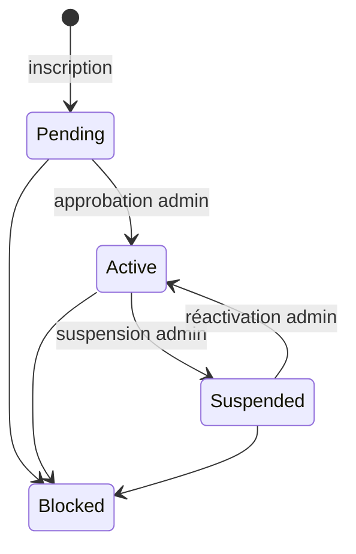

| De | Vers | Acteur / déclencheur | Source | Statut |
|---|---|---|---|---|
| — | Pending | Inscription | CdC §10 | Défini (état initial : déduit) |
| Pending | Active | Admin (« approve ») | CdC §35 | Déduit |
| Active | Suspended | Admin (« suspend ») | CdC §35 | Déduit |
| Suspended | Active | Admin (réactivation) | CdC §36 (prévu pour les exportateurs) | Proposé |
| Pending, Active, Suspended | Blocked | Admin | CdC §10 | Proposé |
| Blocked | — | Réversibilité ? | — | Q-11 |

Droits par statut, lien avec la vérification d'email : Q-11, Q-13. Statuts du compte exportateur : Q-12.

## 3. Vérification exportateur

Une vérification est un enregistrement (VerificationRecord) portant un **niveau** (1 à 4) et un **statut**.

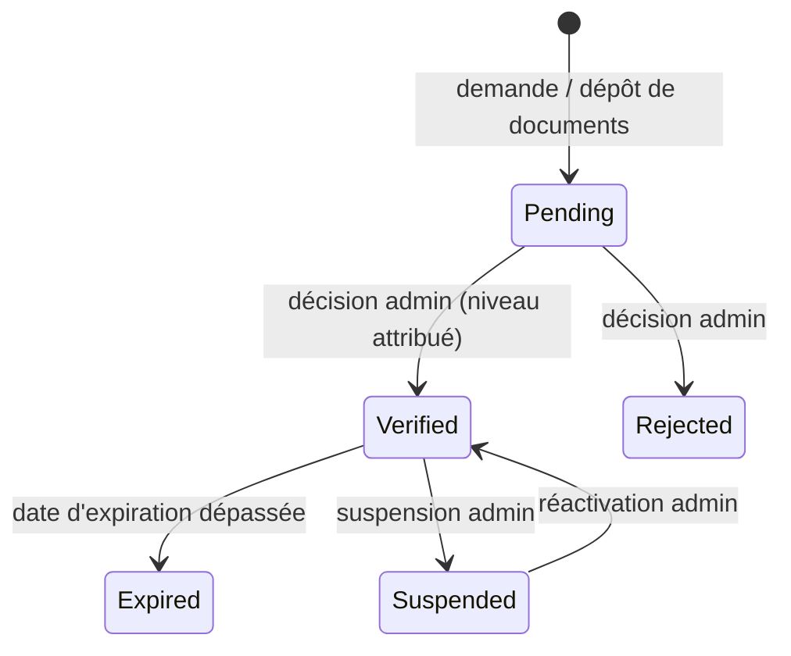

| De | Vers | Acteur | Source | Statut |
|---|---|---|---|---|
| — | Pending | Exportateur (dépôt) ou admin | CdC §8, §36 | Déduit |
| Pending | Verified | Admin autorisé, niveau attribué | CdC §8, §36, RJ 15 | Défini (acteur) |
| Pending | Rejected | Admin autorisé | CdC §36 | Déduit (Q-12) |
| Verified | Expired | Système, à l'expiration | CdC §8 | Déduit (Q-15) |
| Verified | Suspended | Admin | CdC §36 | Déduit (Q-12) |
| Suspended | Verified | Admin (« reactivate ») | CdC §36 | Déduit (Q-12) |

Le CdC §8 ne donne que la liste des statuts. Le CdC §36 liste des **actions de gestion de l'exportateur** (« Approve · Reject · Suspend · Reactivate »), qui peuvent porter sur le compte ou sur la vérification. Les transitions ci-dessus en sont déduites ; la distinction entre statut du compte et statut de vérification relève de Q-12.
| Rejected, Expired | nouvelle demande | Exportateur | — | Proposé (Q-15) |

Changement de niveau : proposition de créer un nouvel enregistrement, pour conserver l'historique de chaque décision (BR-VER-02). `À VALIDER` (Q-15).

## 4. RFQ

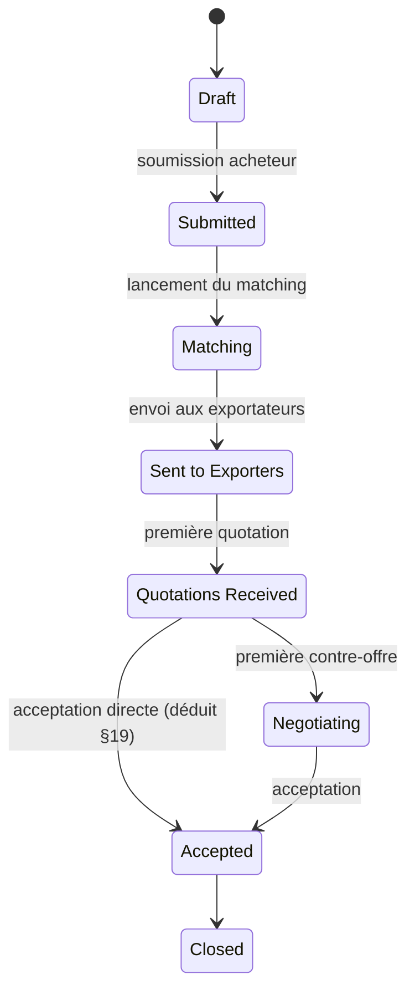

| De | Vers | Acteur / déclencheur | Conditions | Source | Statut |
|---|---|---|---|---|---|
| — | Draft | Acheteur | Compte acheteur autorisé à créer des RFQ (droits par statut : Q-11) | CdC §12, RJ 20 | Défini (création) / Proposé (condition) |
| Draft | Submitted | Acheteur | Champs obligatoires remplis (Q-22) | CdC §12, RJ 20 | Défini |
| Submitted | Matching | Système | — | CdC §14 | Déduit |
| Matching | Sent to Exporters | Système ou admin | Au moins un exportateur retenu (Q-24, Q-31) | CdC §12, RJ 23 | Déduit |
| Sent to Exporters | Quotations Received | Système, à la première quotation | — | CdC §12 | Déduit (première ou toutes ? Q-24) |
| Quotations Received | Negotiating | Système, à la première contre-offre | — | CdC §12 | Déduit |
| Quotations Received | Accepted | Acceptation directe d'une quotation par l'acheteur | Quotation active (BR-QUO-05) | CdC §19 (« Accept ») | Déduit (SRC-05) |
| Negotiating | Accepted | Acceptation d'une proposition | Proposition valide (BR-NEG-03) | CdC §12, §20 | Défini |
| Accepted | Closed | Système ? | Q-24 | CdC §12 | Défini (déclencheur : Q-24) |

États manquants à décider (Q-24) : annulation par l'acheteur, aucun exportateur compatible, aucune quotation reçue, toutes les quotations expirées ou refusées, expiration de la RFQ (Q-23).

## 5. Réponse de l'exportateur à une RFQ

Le CdC §15 définit trois **actions**, pas des statuts : Respond, Decline, Ask Question. Proposition de statuts pour chaque destinataire, `À VALIDER` (Q-24) :

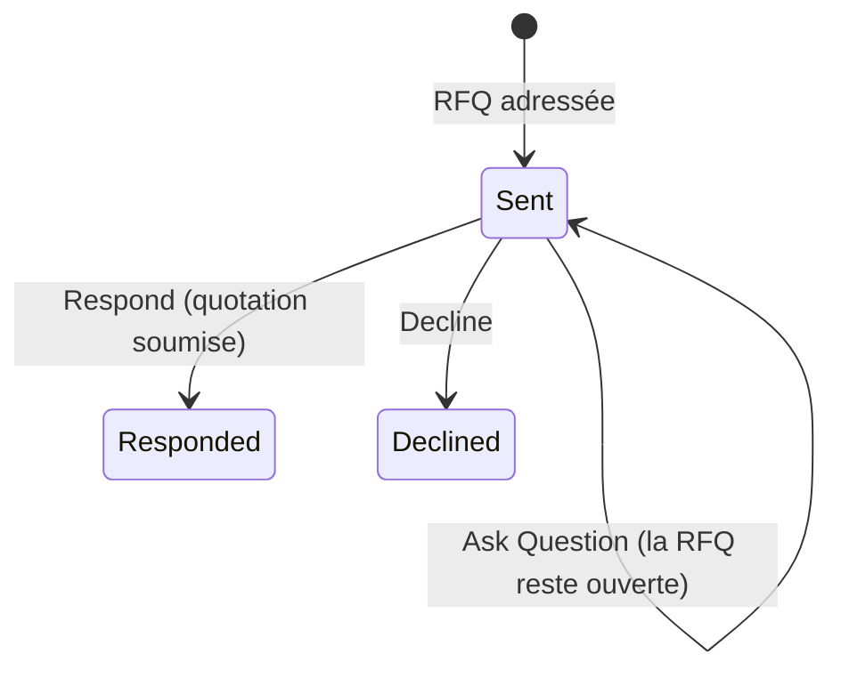

| Action | Effet | Source | Statut |
|---|---|---|---|
| Respond | Création d'une quotation (§6) | CdC §15-16 | Défini (action) |
| Decline | Refus enregistré, motif facultatif ; plus de quotation possible ? | CdC §15 | Défini (action) ; réversibilité : Proposé |
| Ask Question | Question conservée et adressée à l'acheteur (messagerie liée à la RFQ) | CdC §15, §28, RJ 21 | Défini (action) ; canal : Déduit |

## 6. Quotation

Deux dimensions indépendantes.

**6.1 Validité** (CdC §18), déterminée par la date d'expiration par rapport à l'instant présent :

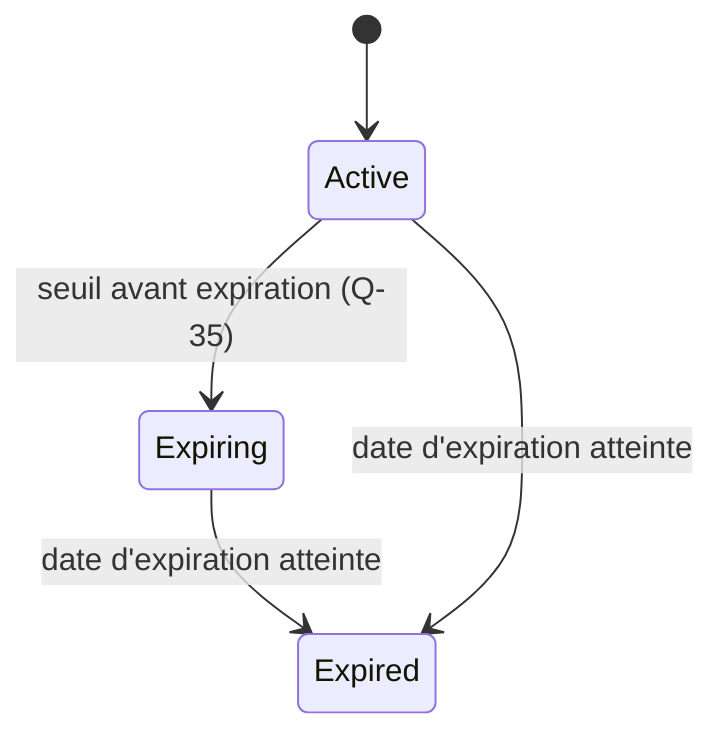

| De | Vers | Déclencheur | Source | Statut |
|---|---|---|---|---|
| — | Active | Soumission avec date d'expiration future | CdC §18 | Défini |
| Active | Expiring | Seuil avant expiration | CdC §18 | Défini (seuil : Q-35) |
| Active, Expiring | Expired | Date d'expiration atteinte | CdC §18 | Défini |
| Expired | Active | Prolongation ? | RJ 25 | Q-36 |

**6.2 Cycle de vie** : non défini par les sources. Proposition, `À VALIDER` (Q-34) :
- Draft → Submitted ;
- Submitted → Accepted, Rejected ou Withdrawn ;
- Submitted → Under Negotiation → Accepted ou Rejected.

Une seule quotation (ou contre-offre) acceptée par RFQ, sauf décision contraire (Q-26).

## 7. Négociation

Le CdC définit les **mouvements** (contre-offre acheteur, contre-offre exportateur, acceptation) et l'historique (CdC §20-21). RJ 26 ajoute refus et expiration. Les statuts ci-dessous sont une **proposition**, `À VALIDER` (Q-38, Q-39).

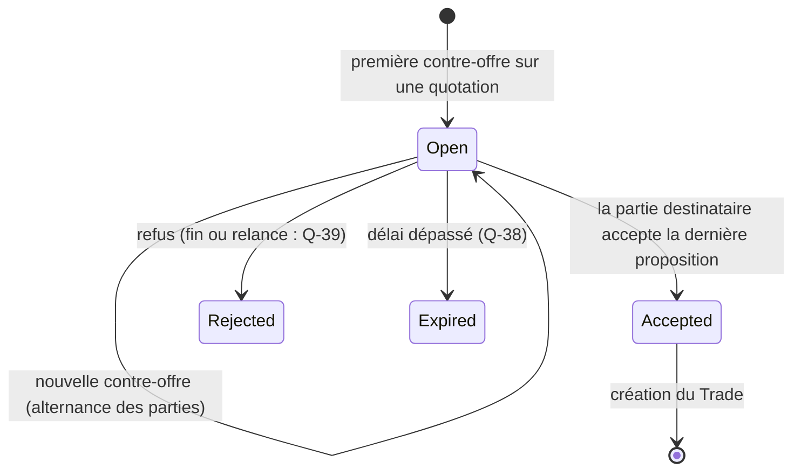

| Mouvement | Auteur | Conditions | Source | Statut |
|---|---|---|---|---|
| Contre-offre | Acheteur ou exportateur, en alternance | La dernière proposition émane de l'autre partie ; quotation non expirée | CdC §20 | Défini (alternance : Déduit) |
| Acceptation | Partie destinataire de la dernière proposition | Proposition encore valide ; aucune acceptation concurrente | CdC §20, §67, RJ 26 | Déduit (BR-NEG-03) |
| Refus | Partie destinataire | — | RJ 26 | Défini (effet : Q-39) |
| Expiration | Système | Délai de la proposition | RJ 26 | Défini (durée : Q-38) |

Chaque proposition est immuable, horodatée et attribuée à son auteur (BR-NEG-01, BR-NEG-02). Statuts de proposition proposés : Pending, Superseded, Accepted, Rejected, Expired (`À VALIDER`).

## 8. Trade

Chemin nominal du CdC §24 :

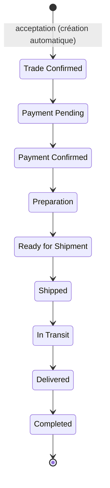

| De | Vers | Acteur / déclencheur | Conditions | Source | Statut |
|---|---|---|---|---|---|
| — | Trade Confirmed | Système, à l'acceptation | Transaction atomique, idempotente (BR-TRD-01 à 03) | CdC §22, §24 | Défini |
| Trade Confirmed | Payment Pending | Système ou acteur ? | Selon les conditions de paiement (Q-45) | CdC §24 | Défini (déclencheur : Q-41) |
| Payment Pending | Payment Confirmed | Admin, en confirmant le Payment Record | Paiement confirmé (BR-PAY-03) ; paiement complet ou partiel (Q-54) | CdC §24, §30 | Déduit |
| Payment Confirmed | Preparation | Exportateur | — | CdC §67 étape 15 | Déduit |
| Preparation | Ready for Shipment | Exportateur ? | Documents requis ? (Q-47) | CdC §24 | Q-41 |
| Ready for Shipment | Shipped | Saisie de l'expédition | Expédition enregistrée | CdC §67 étape 16 | Déduit (acteur : Q-58) |
| Shipped | In Transit | Mise à jour de l'expédition | — | CdC §67 étape 17 | Déduit (Q-58) |
| In Transit | Delivered | Réception par l'acheteur | Confirmation de l'acheteur ou de l'admin ? | CdC §67 étape 18 | Q-41 |
| Delivered | Completed | ? | Q-42 | CdC §24, §67 étape 19 | Q-42 |

Exceptions (CdC §24) :

| Transition | Depuis | Retour | Source | Statut |
|---|---|---|---|---|
| → On Hold | tout état non terminal ? | vers l'état précédent ? | CdC §24 | Q-44 |
| → Disputed | tout état non terminal ? (ouverture d'un litige, §13) | vers l'état précédent ou Cancelled ? | CdC §24, §41 | Q-44, Q-61 |
| → Cancelled | quels états, par qui ? | terminal | CdC §24 | Q-43 |

Proposition : Completed et Cancelled sont des états terminaux (`À VALIDER`).
Chaque transition produit un TradeEvent immuable (BR-TRD-07).

Limite connue : le chemin nominal suppose un **paiement avant la préparation**. Des conditions de paiement différentes (acompte et solde, paiement contre documents, lettre de crédit) ne s'y intègrent pas sans adaptation (Q-45, R-10).

## 9. Trade Journey (timeline)

Le Trade Journey (CdC §25) est la **vue chronologique** des événements. Il est distinct de la machine d'état et couvre l'avant-Trade.

Étapes du CdC §25 : RFQ Submitted → Exporter Matched → Quotation Received → Negotiation → Trade Confirmed → Payment → Preparation → **Inspection** → Shipment → In Transit → Delivered → Completed.

Chaque événement stocke : date, heure, acteur, action, commentaire, document justificatif le cas échéant (CdC §25).

L'étape **Inspection** n'existe pas dans la machine d'état du Trade (§8) et l'inspection est une intégration future (CdC §57). Proposition : en V1, un événement de timeline facultatif, sans statut de Trade associé (`À VALIDER`, Q-46).

## 10. Payment Record

Statuts définis (CdC §30) : Pending, Processing, Confirmed, Failed, Refunded. Transitions **proposées**, `À VALIDER` (Q-54, Q-56) :

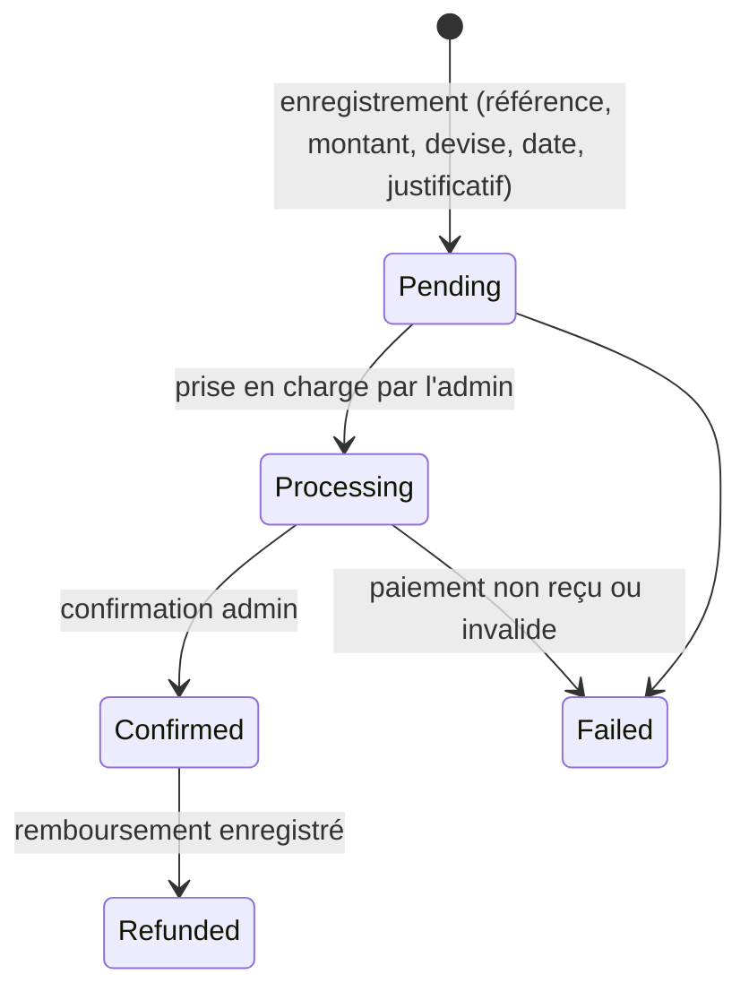

| De | Vers | Acteur | Source | Statut |
|---|---|---|---|---|
| — | Pending | Acheteur, exportateur ou admin (Q-54) | CdC §30 | Défini (statut) ; acteur : Q-54 |
| Pending | Processing | Admin | CdC §30 | Proposé |
| Processing | Confirmed | Admin | CdC §30 (« admin confirmation ») | Déduit |
| Pending, Processing | Failed | Admin | CdC §30 | Proposé |
| Confirmed | Refunded | Admin autorisé | CdC §30, RJ 33 | Proposé (Q-56) |

Le dépôt d'un justificatif ne fait jamais passer en Confirmed (BR-PAY-03).

## 11. Shipment

Statuts définis (CdC §31). L'ordre linéaire est **déduit** de la liste du CdC.

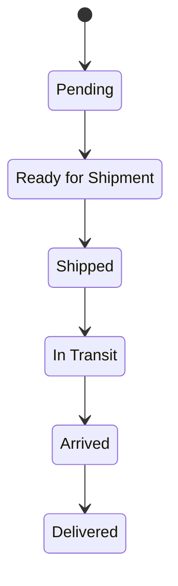

Correspondance proposée avec le Trade, `À VALIDER` (Q-58) :

| Shipment | Trade |
|---|---|
| Pending | Preparation |
| Ready for Shipment | Ready for Shipment |
| Shipped | Shipped |
| In Transit | In Transit |
| Arrived | (pas d'équivalent ; le Trade reste In Transit) |
| Delivered | Delivered |

Plusieurs expéditions par Trade (livraisons partielles) : Q-57. Chaque mise à jour est historisée (TrackingEvent saisi manuellement, BR-SHP-02).

## 12. Demande d'échantillon

Défini par le CdC §27 (inclusion V1 : Q-53) :

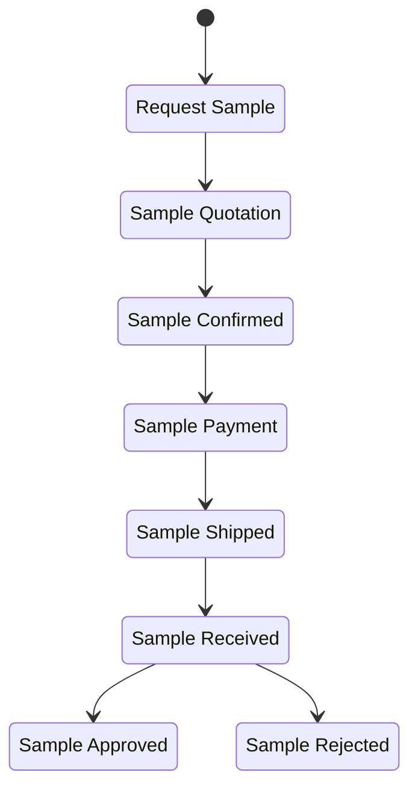

Acteurs déduits :
- acheteur : demande, confirmation, réception, approbation ou rejet ;
- exportateur : devis, expédition ;
- paiement de l'échantillon : acteur et mécanisme à définir (Q-53).

Non définis (Q-53) : refus par l'exportateur, annulation, échantillon gratuit (sans paiement). Liaison à une RFQ : facultative (CdC §27).

## 13. Litige

Statuts définis (CdC §41). L'ordre linéaire est **déduit**.

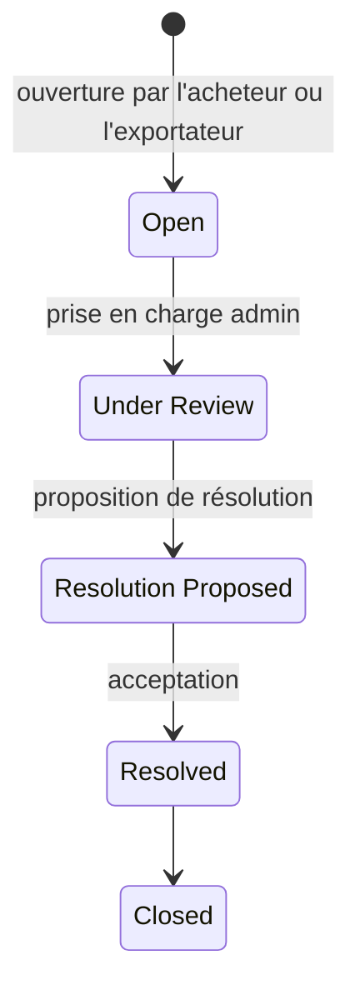

Non définis (Q-61) : refus d'une résolution (retour en Under Review ?), qui accepte la résolution, effet sur le Trade (Disputed → état précédent, Cancelled ou Completed) et sur les paiements (Refunded).

## 14. Exception

Le CdC §40 définit des **types** d'exception et des **actions** admin (enquêter, assigner, commenter, changer le statut, résoudre, escalader), sans statuts. Proposition, `À VALIDER` (Q-60) :

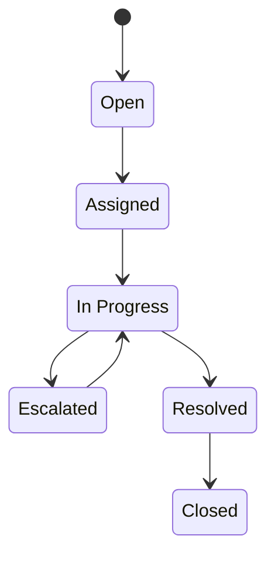

Exceptions potentiellement détectées automatiquement par le système (quotation expirée, exportateur sans réponse, paiement en retard, expédition en retard) : seuils et activation à définir (Q-60).

## 15. Produit (catalogue)

Les sources ne définissent pas de statuts. RJ 17 cite publication, dépublication et archivage logique. Proposition, `À VALIDER` (Q-19) :

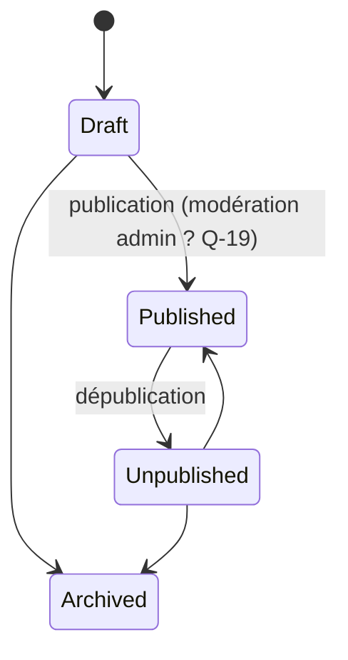

Un produit lié à une RFQ ou à un Trade n'est jamais supprimé physiquement (BR-PRD-05).

## 16. Événements déclencheurs de notifications

Événements définis par le CdC §29. Les destinataires sont **proposés** (Q-52).

| Événement (CdC §29) | Déclencheur | Destinataires proposés |
|---|---|---|
| New RFQ received | RFQ → Sent to Exporters | Exportateurs destinataires |
| New quotation received | Quotation soumise | Acheteur de la RFQ |
| Buyer submitted a counteroffer | Contre-offre de l'acheteur | Exportateur de la quotation |
| Quotation accepted | Acceptation | Les deux parties, admin |
| New Trade created | Trade → Trade Confirmed | Les deux parties, admin |
| Payment confirmed | Payment Record → Confirmed | Les deux parties |
| New document uploaded | Document déposé sur un Trade | L'autre partie, si le document lui est visible |
| Trade status updated | Toute transition du Trade | Les deux parties |
| Sample shipped | Échantillon → Sample Shipped | Acheteur |

Non listés par le CdC mais probablement nécessaires (Q-52) : contre-offre de l'exportateur (le CdC ne cite que celle de l'acheteur), décision de vérification, quotation bientôt expirée, ouverture de litige.
